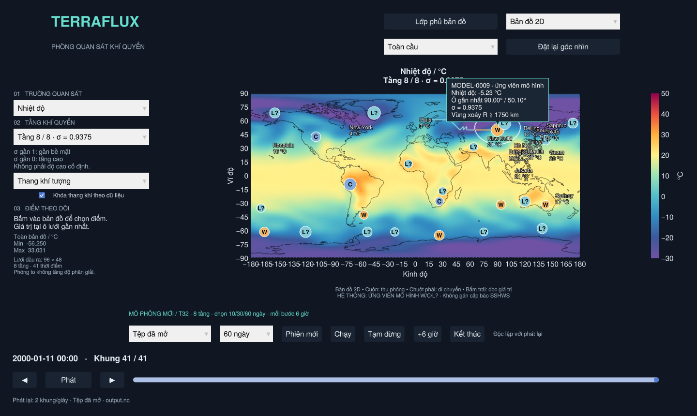
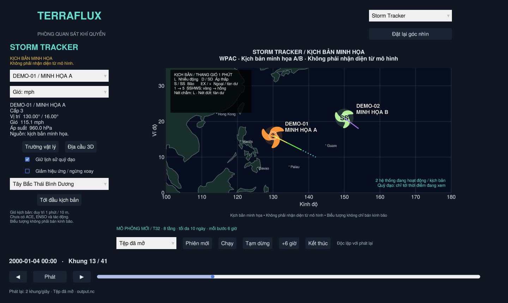
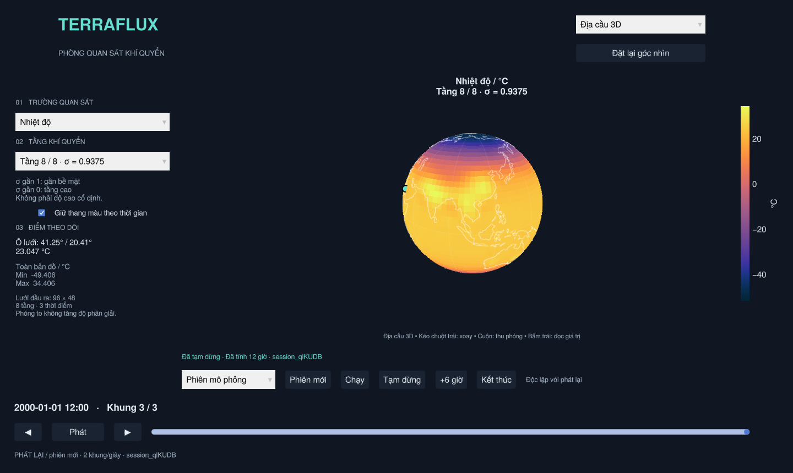
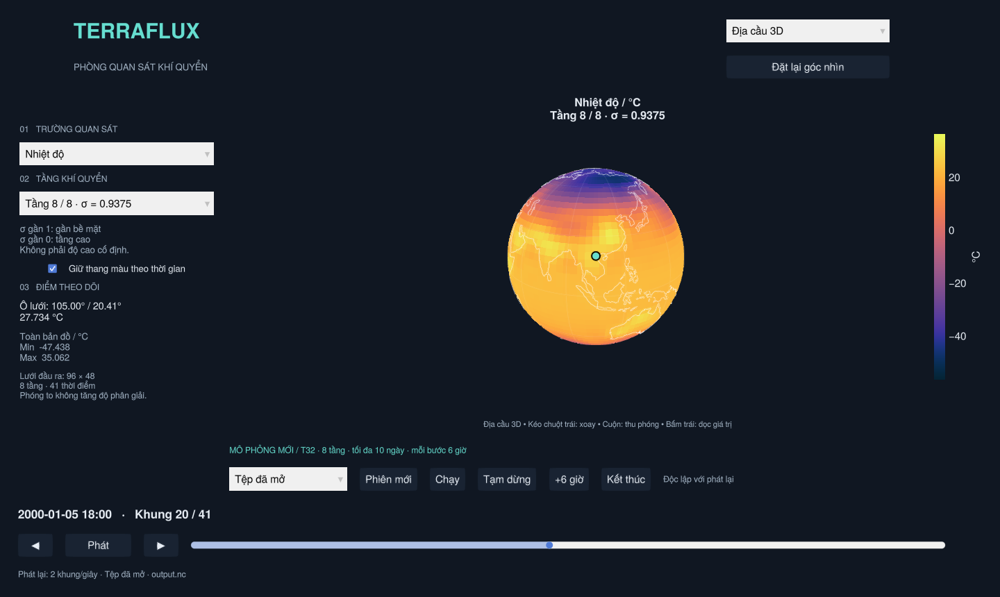

# TerraFlux

Trình quan sát khí quyển từ dữ liệu mô phỏng SpeedyWeather. Bản V1 hiện tại mở dữ liệu NetCDF đã ghi, không chạy lại mô phỏng khi kéo thời gian.

Các sửa lỗi và kết quả đo hiệu năng gần đây: [PERFORMANCE_FIXES.md](docs/PERFORMANCE_FIXES.md).



## Mở trên Windows

1. Cài **Julia 1.13.3**, bảo đảm lệnh `julia --version` chạy được trong Terminal. Có thể cài qua [Juliaup](https://julialang.org/downloads/).
2. Tải/clone toàn bộ repo về máy, giải nén nếu dùng ZIP.
3. Bấm đúp **`Open_TerraFlux.bat`**.

Lần đầu cần Internet để Julia cài thư viện và biên dịch; cửa sổ dòng lệnh sẽ hiện tiến trình. Những lần sau dùng lại bộ nhớ đệm. Giao diện cần driver đồ họa hỗ trợ **OpenGL 3.3**. Nếu mở lỗi, cửa sổ dòng lệnh sẽ giữ lại thông báo để kiểm tra.

Mặc định mở bộ **60 ngày / 241 khung** tại `datasets/earth_60d/run_0001/output.nc`
đã được tính sẵn; bạn không cần chạy lại mô hình để xem. Nếu chưa có bộ này,
app dùng `run_0001/output.nc` cũ (10 ngày). Có thể kéo thả một tệp `output.nc`
khác lên `Open_TerraFlux.bat`; đường dẫn chứa dấu cách được hỗ trợ. Tệp cần
`lon`, `lat`, `layer`, `time`, `temp`, `u`, `v`, `humid`, `mslp`; `pres` bổ sung
áp suất bề mặt để tính RH. Đây là thí nghiệm khí quyển T32, không phải dự báo.

Linux/macOS, với Julia trong PATH:

```sh
./open_terraflux.sh
# Hoặc chọn dữ liệu khác:
./open_terraflux.sh /path/to/output.nc
```

Từ Terminal, trên mọi hệ điều hành:

```sh
julia --project=. viewer.jl --setup
julia --project=. viewer.jl /path/to/output.nc
```

## Bản đồ khí tượng và gió chuyển động

- Bảng màu theo phong cách ảnh tham chiếu: nhiệt độ −30…50 °C, tốc độ gió
  0…120 km/h, RH 0…100%, áp suất 970…1045 hPa; có menu **Theo dữ liệu**.
- **Hạt gió** có vệt trắng, đọc u/v đúng tầng/thời điểm, hoạt động trên 2D/3D.
  Có thể xem hướng gió khi tạm dừng thời gian; chuyển động này là hiển thị dòng
  gió snapshot, không làm mô phỏng tiến lên. [Video minh họa](docs/wind_animation.mp4).
- **Mượt bản đồ 2D/3D**, đường đẳng áp 4 hPa, chọn vùng Châu Á–Thái Bình Dương/toàn cầu.
- Bấm **Lớp phủ bản đồ** để bật/tắt hạt gió, hệ thống xoáy, địa danh, giá trị,
  ngày/đêm và lưới. Rê chuột đọc trường đang chọn và vùng xoáy: [hướng dẫn](docs/MAP_OVERLAYS.md).
- Độ ẩm tương đối tính từ q/T/**áp suất bề mặt thực** theo tầng sigma; tệp cũ
  thiếu áp suất bề mặt ghi thiếu RH. Độ ẩm riêng g/kg vẫn có mục riêng.
- Chỉnh màu/thang đo/số hạt/độ dài vệt/tốc độ trong
  [`assets/weather/style.toml`](assets/weather/style.toml), rồi mở lại app.

Ảnh bốn trường, công thức, cách dùng và tái tạo bộ 60 ngày ở
**[WEATHER_MAPS.md](docs/WEATHER_MAPS.md)**. Bộ mới giữ T32/8 tầng, ghi mỗi 6 giờ,
có cấu hình/kiểm chứng/restart đi kèm tại `datasets/earth_60d/`.

## Storm Tracker — kịch bản và ứng viên từ mô hình

Chọn **Storm Tracker** trong menu góc trên phải. Với dữ liệu mẫu, kéo thanh thời gian tới **2000-01-04 00:00** (khung 13) để xem hai hệ thống cùng hoạt động, hoặc bấm **Tới mốc đầu** để bắt đầu từ ngày 1.



- Đây là **kịch bản thử được khai báo trong `scenarios/demo_storms.toml`**, không phải bão được nhận diện từ SpeedyWeather, dữ liệu quan trắc hay dự báo. Vị trí, gió và áp suất trong kịch bản không làm thay đổi mô hình khí quyển. Nhãn nguồn luôn hiện trong chế độ này.
- ID ổn định `DEMO-01` và `DEMO-02`, biểu tượng/màu theo trạng thái, quỹ đạo lịch sử và đồng hồ dùng chung thanh thời gian với các chế độ hiện có. Không vẽ phần quỹ đạo tương lai. Sau khi hệ thống kết thúc, biểu tượng biến mất và lịch sử/dấu kết thúc được giữ nếu bật tùy chọn.
- Bấm biểu tượng hoặc chọn trong danh sách để đọc thông tin. Đổi đơn vị gió giữa knot, m/s, km/h và mph. Trường áp suất không được khai báo sẽ hiện **chưa có dữ liệu**.
- **Trường vật lý** và **Địa cầu 3D** chuyển sang vị trí ô lưới gần tâm đã chọn, giữ nguyên thời gian. Các trường vật lý vẫn là dữ liệu SpeedyWeather độc lập; chúng không được tạo ra từ kịch bản minh họa. Lớp phủ hệ thống trên bản đồ vật lý/địa cầu được bật riêng trong **Lớp phủ bản đồ**.
- Có tùy chọn giữ lịch sử, ngừng xoay để giảm hiệu ứng và chọn phạm vi WPAC/toàn cầu. Phát/Dừng tiếp tục dùng các nút phát lại bên dưới. Chuyển chế độ không chạy thêm hay sửa mô phỏng.
- Các cánh biểu tượng xoay theo bán cầu, phục vụ đọc giao diện; kích thước thay đổi tương đối theo bán kính vùng xoáy khi có dữ liệu; icon pixel không phải vòng phạm vi đúng tỉ lệ km. Tốc độ animation không phải tốc độ gió vật lý. Tên phụ được rút gọn khi hệ thống ở gần hệ thống đang chọn; chưa có bộ giải quyết mọi trường hợp nhãn chồng nhau.
- Nội suy tuyến tính vị trí giữa các mốc kịch bản; gió/áp suất nội suy trong cùng loại, giữ mốc trước khi hai đầu khác loại. Trạng thái loại đổi tại mốc khai báo. Quỹ đạo tô theo cấp ở đầu từng đoạn; nhiễu động dùng nét chấm, tàn dư dùng nét đứt. Đường qua kinh tuyến đổi ngày được ngắt để không vẽ một dây nối ngang cả bản đồ.
- Thang hiển thị dùng gió duy trì **1 phút / 10 m**, ngưỡng knot: D <34; S ≥34; C1 ≥64; C2 ≥83; C3 ≥96; C4 ≥113; C5 ≥137. Các nhóm ngoại nhiệt đới/tàn dư/nhiễu động do kịch bản khai báo; cận nhiệt đới dùng SD/SS theo ngưỡng 34 knot. Không tự phân loại gió trên các tầng T32 thành bão SSHWS.
- Nền hiện là đa giác đất và đường bờ Natural Earth, kèm một số địa danh tham chiếu; chưa có ảnh vệ tinh. ACE, ENSO, thiệt hại, thương vong, biểu đồ mùa và xác nhận/phân loại bão nhiệt đới từ mô hình **chưa được triển khai**, không có số trang trí thay thế.

Ngày của kịch bản mẫu là 2000-01-01…2000-01-08 để trùng trục thời gian dữ liệu mẫu. Nếu mở tệp thời gian khác, kịch bản không tự dịch sang năm mới và có thể không có hệ thống trong khoảng đang xem. Hướng dẫn cấu trúc dữ liệu ở [`scenarios/README.md`](scenarios/README.md); yêu cầu đầy đủ và việc còn chờ ở [`docs/UI_BACKLOG.md`](docs/UI_BACKLOG.md).

**Quy tắc Mỹ và nguồn tiếng Anh:** [`STORM_CLASSIFICATION_US.txt`](STORM_CLASSIFICATION_US.txt).
Quy tắc tập trung trong `src/classification.jl`, tách loại hệ thống, chuẩn gió và
lưu vực. Kịch bản WPAC hiển thị **Typhoon từ 64 kt**, **Super typhoon từ 130 kt**;
số/màu C1–C5 ghi là tương đương SSHWS. STY 130 kt vẫn là C4, chưa phải C5.
Hurricane/Major hurricane dùng ở các lưu vực hurricane của Mỹ. Vùng áp thấp,
nhiễu động, cận nhiệt đới, ngoại/hậu nhiệt đới và tàn dư có quy tắc riêng;
đổi đơn vị hay góc nhìn không đổi phân loại. API không biết chuẩn gió sẽ trả
chưa xếp cường độ. `L?` từ mô hình vẫn chưa đủ căn cứ để gọi TD/TS/TY.

### Ứng viên từ dữ liệu khí quyển thật của mô hình

Trong Storm Tracker, chọn nguồn **Ứng viên từ mô hình** ở đầu bảng bên trái, chờ phân tích rồi bấm **Tới mốc đầu**. Bộ phân tích đọc áp suất và gió của **tệp/phiên đang mở**, tìm cực tiểu MSLP có độ trũng áp suất và xoáy thuận, rồi nối tâm qua các mốc thời gian. Nhãn `MODEL-…` ổn định trong từng tập dữ liệu; chỉ hiện ID sau khi nó đã xuất hiện ở mốc đang xem.


**W/C/L? là nhóm cấu trúc sơ bộ, chưa xác nhận bão nhiệt đới và không gán SSHWS.**
W: dấu hiệu lõi ấm; C: dấu hiệu lõi lạnh; L?: hỗn hợp hoặc thiếu dữ liệu. Bộ phân
tích dùng dị thường nhiệt hai dải sigma so với nền quanh tâm, kèm kiểm tra gió
xoáy bốn phía. Thẻ hiển thị hai dị thường, trạng thái gió, MSLP ô tâm, độ trũng
Δp, độ xoáy ζ và cực đại gió ô lưới trên tầng sigma thấp nhất. Gió này không phải
gió 10 m duy trì 1 phút. Các ngưỡng cấu trúc là thử nghiệm, chưa kiểm định bằng
quan trắc; W không đồng nghĩa TC, C chưa đủ để kết luận EX.

Mặc định chỉ hiện **Đang hoạt động** với chấm nhỏ; chỉ tâm đang chọn có tên và
quỹ đạo. Bộ lọc mới cho xem riêng lõi ấm/lạnh/chưa rõ, hoặc **Tất cả + lịch sử**
để xem các track đã mất dấu. Khi tâm đang chọn hết hoạt động, menu tự chọn một
tâm còn hoạt động. **Tới mốc đầu** tuân theo bộ lọc đang chọn. Mất tiêu chí ngắt
track, không mặc nhiên kết luận bão đã tan; không bù hoặc nội suy mốc mô hình.

Hai nguồn được giữ riêng: dữ liệu DEMO không xuất hiện trong kết quả mô hình. Có thể chuyển sang trường vật lý/địa cầu để đối chiếu cùng ô và thời gian. Đổi tệp hoặc nhận mốc live mới sẽ làm mới cache phân tích; kết quả rỗng/dữ liệu thiếu được hiển thị rõ. Các file `.bat`/`.sh` mở Julia với 2 luồng; nếu chạy lệnh thủ công nên dùng `julia --threads=2 --project=. viewer.jl` để bộ phân tích có luồng tính riêng.

Tiêu chí số, cách nối ID, công thức, dữ liệu thiếu và giới hạn khoa học được ghi đầy đủ trong **[MODEL_DETECTION.md](docs/MODEL_DETECTION.md)**. Đây là heuristic thử nghiệm trên lưới T32, chưa kiểm định độ chính xác với quan trắc; địa hình, rãnh áp và hệ ngoại nhiệt đới có thể tạo ứng viên giả. Chưa xác nhận lõi ấm/hoàn lưu kín hay cấp bão, ACE và tác động.

### Thay icon/animation bão

Sửa **[`assets/storm_tracker/style.toml`](assets/storm_tracker/style.toml)** rồi mở lại app. Có thể chỉnh kích thước, quầng sáng, số cánh/hình dạng dự phòng, tốc độ xoay; hoặc dùng PNG trong suốt và dải PNG nhiều khung, dùng chung hoặc riêng từng cấp. Hướng dẫn và ví dụ tại **[`assets/storm_tracker/README.md`](assets/storm_tracker/README.md)**. Điểm mở rộng bằng Julia nằm ở `src/storm_icons.jl`.

## Tạo mô phỏng theo số ngày và chất lượng

Bấm đúp **[`Create_Simulation.bat`](Create_Simulation.bat)** (Linux/macOS:
`./create_simulation.sh`). Chọn **1–365 ngày**, **T21/T32/T63/T85**, **8/16/24/32
tầng**, chu kỳ lưu, luồng CPU và seed, rồi **Tạo và chạy**. Khi hoàn tất, bấm
**Mở kết quả**. Mỗi lần tạo lưu thư mục mới cùng cấu hình/nhật ký/manifest, không
ghi đè bộ mẫu. [Hướng dẫn, ước lượng RAM và giới hạn](docs/LOCAL_SIMULATION.md).
Form báo riêng giai đoạn/tiến độ/ETA; nút **Mở nhật ký** xem lỗi chi tiết.
Lỗi khởi động được lưu trong `simulation_setup.log` cạnh file `.bat`/`.sh`.

**GPU:** dựng hình qua OpenGL; **phép tính khí quyển hiện dùng CPU**. Thư viện có
hỗ trợ CUDA nhưng project chưa tích hợp/kiểm chứng backend GPU.
[Xem trạng thái GPU](docs/GPU_STATUS.md).

## Chạy mô phỏng trực tiếp trong viewer

Dải **MÔ PHỎNG MỚI** nằm ngay phía trên phần phát lại:

1. Chọn thời lượng **10/30/60 ngày** và **Chất lượng phiên mới**: T21/T32/T63/T85, 8/16/24/32 tầng, CPU hoặc NVIDIA CUDA nếu máy có CUDA khả dụng. Bấm **Phiên mới** để khởi tạo từ điều kiện mặc định SpeedyWeather. Các lựa chọn chỉ áp dụng lúc tạo phiên; không tiếp tục từ khung đang xem hay đổi lưới của phiên đang chạy.
2. Chờ trạng thái **Đã tạm dừng**, rồi bấm **+6 giờ** để tính một bước, hoặc **Chạy** để tính liên tiếp.
3. **Tạm dừng** yêu cầu dừng sau mốc 6 giờ đang tính. Trong lúc chờ, giao diện báo lệnh chưa xử lý; nó không hủy nửa chừng một bước.
4. **Kết thúc** đóng phiên sau mốc đang tính. Sau đó có thể tạo phiên khác.

Các nút này điều khiển **phép tính vật lý**. Nút **Phát/Dừng** và thanh thời gian bên dưới chỉ phát lại dữ liệu đã ghi. Mốc mới tự xuất hiện trên bản đồ/địa cầu sau mỗi 6 giờ tính xong; khi xem nguồn phiên đang chạy, giao diện theo mốc mới nhất. Có thể tạm dừng để xem lại các mốc cũ. Menu nguồn cho phép trở về **Tệp đã mở** trong khi phiên tiếp tục tính.

- Bước tính đầu tiên của mỗi tiến trình phiên mới có thể mất vài phút để Julia biên dịch. Cửa sổ vẫn xoay bản đồ/địa cầu và xem dữ liệu đã có được trong thời gian này. Phiên mới có thể cần Internet để SpeedyWeather tải dữ liệu điều kiện biên.
- Mỗi phiên giữ cố định thời lượng/T/số tầng/backend lúc tạo. Menu mặc định gợi ý T/số tầng từ tệp mở nếu có metadata phù hợp; bạn có thể chọn khác. Khi đổi nguồn tệp/live, viewer cập nhật cả lưới 2D/3D và menu tầng. Tệp ngoài thiếu metadata vẫn cho chọn cấu hình phiên mới.
- CUDA chỉ hiện khi phần cứng/driver khả dụng; mặc định CPU. Lưu/khôi phục trạng thái phiên hiện hỗ trợ CPU; phiên CUDA vẫn xuất NetCDF để xem lại.
- SpeedyWeather chưa tính chẩn đoán nhiệt độ sát bề mặt cần cho **áp suất quy mực biển ở mốc khởi tạo**. Giao diện phiên mới ghi rõ trường này thiếu dữ liệu tại mốc 0, không thay bằng giá trị giả. Các trường trạng thái và mọi đầu ra tại mốc đã tính từ 6 giờ trở đi đều được kiểm tra hữu hạn; phát hiện mất ổn định sẽ dừng và báo lỗi.
- Phiên lưu ở `sessions/session_…/`: cấu hình `config.toml`, nhật ký lệnh `commands/`, trạng thái `status.toml`, lỗi/tiến trình `worker.log`, và các thư mục `run_…` chứa NetCDF cùng `restart.jld2`. `sessions/` không được đưa vào Git. NetCDF thô của đoạn đầu vẫn chứa chẩn đoán áp suất khởi tạo chưa hợp lệ; dùng các mốc từ 6 giờ để phân tích áp suất.
- Khi đóng cửa sổ, ứng dụng yêu cầu tiến trình mô phỏng kết thúc; nếu nó còn bận sau 3 giây thì dừng tiến trình đó. Những đoạn đã hoàn tất được giữ lại; đoạn đang tính có thể chưa hoàn chỉnh. Giao diện chỉ nạp các tệp đã đóng và vượt qua kiểm tra. Muốn tính tiếp lần sau, dùng **Lưu phiên** trước khi kết thúc (hướng dẫn bên dưới).
- Mô hình được chạy nối tiếp bằng các lời gọi `run!` 6 giờ được thư viện hỗ trợ. Bộ kiểm tra xác nhận đồng hồ liên tục và trạng thái tiến triển; chưa khẳng định kết quả trùng bit với một lời gọi dài 10 ngày.



## Lưu phiên để tính tiếp lần sau

Tạm dừng phiên live sau ít nhất **+6 giờ**, rồi bấm **Lưu phiên**. Chờ thông
báo hoàn tất và giữ cả thư mục chứa `session.toml` mà giao diện cung cấp.
Lần sau, dán đường dẫn vào ô cạnh nút rồi bấm **Mở phiên đã lưu**; ứng dụng
khôi phục ở trạng thái tạm dừng, sẵn sàng tính tiếp bằng **+6 giờ/Chạy**.

Bản lưu giữ trạng thái vật lý, RNG, lịch sử, tác động nhiệt đang chờ và hoàn
tác còn hiệu lực. Mở lại tạo workspace riêng, giữ nguyên bản lưu gốc. Nếu khác
T/số tầng với cửa sổ đang mở, kéo `session.toml` lên `Open_TerraFlux.bat`.
Cần cùng phiên bản Julia/SpeedyWeather; lưu trước khi worker kết thúc. Không
khôi phục trực tiếp từ NetCDF/restart batch. [Chi tiết](docs/SAVED_SESSIONS.md).

## Thí nghiệm A/B

Bấm **Thí nghiệm A/B** ở dải lưu phiên, hoặc mở **Compare_Experiments.bat**.
Chọn một bản lưu chưa có tác động chờ, số bước 6 giờ và cấu hình nhiệt cho B,
rồi **Tạo và chạy A/B**. A/B dùng cùng trạng thái xuất phát; A không nhận tác
động mới, B nhận tác động một lần. Có ba bản đồ **A, B, Δ = B − A**, chung tầng,
thời gian và vùng xem; A/B dùng cùng thang màu. Chỉ so sánh mốc mới chung.

Mỗi nhánh có bản lưu cuối để mở bằng viewer; kết quả A/B mở lại bằng
`comparison.toml`. Linux/macOS dùng `./compare_experiments.sh`.
[Hướng dẫn và giới hạn](docs/AB_EXPERIMENTS.md).

## Địa cầu 3D

Chọn **Địa cầu 3D** trong menu ở góc trên bên phải; chọn **Bản đồ 2D** để quay lại. Hai chế độ dùng chung trường, tầng, thời gian, điểm theo dõi và thang màu.

- Giữ/kéo chuột trái để xoay, cuộn chuột để thu/phóng. Camera luôn ở ngoài mặt cầu.
- Bấm rồi thả tại chỗ trên địa cầu để đọc ô lưới gần nhất ở mặt đang nhìn. Kéo để xoay hoặc bấm vào khoảng trống không đổi điểm theo dõi.
- Nút **Đặt lại góc nhìn** đưa địa cầu về hướng Đông Nam Á; ở bản đồ 2D nút này khôi phục vùng đang chọn trong menu.
- Màu nội suy song tuyến tính trên mesh mịn dùng chung đỉnh, đường bờ chia nhỏ theo cung cầu. Có thể tắt mượt trong Lớp phủ bản đồ để xem ô gốc; mượt hình không tạo thêm chi tiết vật lý. Hai cực hội tụ về trung bình hàng gần nhất. Mặt cầu chỉ là cách trình bày tầng đang chọn, không biểu diễn độ cao thật của tầng sigma.
- Đường bờ lấy từ Natural Earth; các đường kinh/vĩ tuyến giúp định hướng. Không cần tải thêm dữ liệu địa cầu.



## Can thiệp nhiệt — mốc đầu của V2

Bấm **Can thiệp nhiệt** ở đầu bản đồ/địa cầu. Tạo phiên live, tính **+6 giờ**
rồi tạm dừng; chọn tâm, tầng, R và ΔT để làm nóng/lạnh một vùng **một lần**.
Có xem trước, checkpoint trước/sau, nhật ký và hoàn tác trước bước tính mới.
Khung đã lưu giữ nguyên; bấm **+6 giờ** để xem phản ứng sau tác động.
[Hướng dẫn và giới hạn](docs/THERMAL_EXPERIMENTS.md).

## Khởi tạo xoáy lý tưởng

Bấm **Khởi tạo xoáy** trong viewer, chọn tâm/R/trũng áp tham chiếu/độ giảm theo
cao, rồi chèn vào phiên live đã tạm dừng ở mốc cuối. Gió, áp suất bề mặt và
lõi ấm được tạo theo cùng một mẫu toàn cột, có kiểm tra độ phân giải, checkpoint
và hoàn tác. Khung cũ giữ nguyên; **+6 giờ** để xem mô hình tính diễn biến.

T32 dùng mẫu rộng; T63/T85 cho phép thử mẫu nhỏ hơn ở vĩ độ thấp. Đây là xoáy
lý tưởng hóa, **chưa phải bão nhiệt đới được xác nhận**. Trong cửa sổ A/B có lựa
chọn **B: xoáy lý tưởng** để đối chiếu với nhánh không nhận tác động mới.
[Cách dùng, công thức và giới hạn](docs/IDEALIZED_VORTEX.md).

## Sử dụng

- **Trường quan sát:** nhiệt độ (°C), tốc độ gió (km/h), u/v (m/s), độ ẩm riêng (g/kg), độ ẩm tương đối (%), áp suất quy mực biển (hPa).
- **Tầng:** chọn một trong 8 tầng của dữ liệu mẫu. Sigma gần 1 là gần bề mặt, gần 0 là tầng cao. Đây không phải độ cao cố định. Áp suất quy mực biển là trường 2D, không thay đổi khi chọn tầng.
- **Thời gian:** kéo thanh hoặc bấm nút tiến/lùi. Nút Phát/Dừng phát lại 2 khung/giây, dừng ở khung cuối. Bộ mới có 241 khung trong 60 ngày; bộ cũ có 41 khung trong 10 ngày, đều cách nhau 6 giờ. Thời gian là thời gian vật lý của mô hình.
- **Đọc tại điểm:** rê chuột để xem popup theo trường/tầng đang chọn; bấm trái vào bản đồ để ghim điểm. Dấu chấm và bảng bên trái chỉ tọa độ/giá trị tại ô lưới gần nhất; điểm được giữ khi đổi tầng, trường và thời gian. Không nội suy giá trị tại vị trí chuột.
- **Thang màu:** mặc định dùng thang khí tượng cố định. Chọn Theo dữ liệu để dùng min/max; checkbox khóa giữ cùng thang giữa các khung, bỏ chọn để co giãn theo từng khung. Gió u/v dùng thang đối xứng quanh 0.
- **Bản đồ:** cuộn để thu/phóng, giữ chuột phải để di chuyển; Ctrl + bấm trái để đặt lại. Phóng to không tăng độ phân giải vật lý.

Phần bản đồ dùng kinh độ −180…180°, vĩ độ −90…90°, đường bờ Natural Earth được đóng gói cùng GeoMakie. Nhiệt độ trong NetCDF mẫu đã là °C, không trừ Kelvin thêm lần nữa. Độ ẩm kg/kg được đổi sang g/kg. Dữ liệu thiếu được bỏ qua khi tính thang màu/thống kê, hiện trong bảng điểm dưới dạng “Thiếu dữ liệu”.

## Cấu trúc

- `src/data.jl`: đọc/kiểm tra NetCDF, chuẩn hóa tọa độ và đơn vị, chọn trường/tầng/thời gian.
- `src/viewer.jl`: giao diện GLMakie, bản đồ/địa cầu, các điều khiển và phát lại.
- `src/globe.jl`: hình học từng ô địa cầu, chuyển tọa độ và chọn mặt cầu bằng tia nhìn.
- `src/weather_style.jl`, `src/wind_particles.jl`: bảng màu/đơn vị hiển thị và hạt gió.
- `src/live.jl`, `src/live_worker.jl`: điều khiển tiến trình mô phỏng riêng và công bố các đoạn dữ liệu hoàn tất.
- `src/saved_sessions.jl`, `src/session_snapshot.jl`: bản lưu độc lập, kiểm tra toàn vẹn và khôi phục live.
- `src/comparison*.jl`, `compare_experiments.jl`: tạo cặp A/B, tính lần lượt và xem bản đồ chênh lệch.
- `src/model_chunk.jl`: bước 6 giờ/kiểm chứng dùng chung cho live và A/B.
- `src/storms.jl`, `src/tracker.jl`: dữ liệu kịch bản và giao diện Storm Tracker.
- `viewer.jl`: điểm khởi chạy, nhận đường dẫn dữ liệu.
- `main.jl`, `check_model.jl`: mô phỏng và kiểm tra trạng thái hiện có.
- `generate_long_run.jl`: tạo và kiểm chứng thí nghiệm theo ngày/T/tầng/chu kỳ lưu.
- `simulation_setup.jl`, `src/batch*.jl`: form tạo phiên và tiến trình tính độc lập.
- `src/map_layers.jl`, `src/hover.jl`, `src/map_math.jl`: lớp phủ, đọc tại chuột và hình học/ngày đêm.
- `note1.txt`: mục tiêu và lộ trình phát triển.

Can thiệp nhiệt một lần, hoàn tác và lưu/mở lại phiên đã có. Chỉnh ẩm/gió tự do và tác động tăng dần/duy trì vẫn còn chờ; thí nghiệm A/B từ bản lưu đã có.

## Kiểm tra

Kiểm thử tọa độ, chuyển đổi đơn vị, chọn điểm, thang màu và đối chiếu trực tiếp dữ liệu mẫu:

```sh
julia --project=. test/runtests.jl
```

Kiểm thử giao diện 2D/3D: đổi trường/tầng/thời gian, chọn điểm, xoay, thu/phóng, đặt lại camera (cần màn hình và OpenGL; trên Linux có thể dùng Xvfb):

```sh
julia --project=. test/viewer_smoke.jl
```

Kiểm thử tích hợp với mô hình thật (lần đầu cần thời gian biên dịch và dữ liệu điều kiện biên):

```sh
julia --project=. test/live_smoke.jl
julia --project=. test/live_cleanup.jl
# Kiểm tra nút giao diện với một worker thật, cần màn hình/OpenGL:
julia --project=. test/live_viewer_smoke.jl
```

Kiểm tra schema/phân loại/thời gian/quỹ đạo của kịch bản, và giao diện Storm Tracker:

```sh
julia --project=. test/storms.jl
# Cần màn hình/OpenGL:
julia --project=. test/tracker_smoke.jl
```

Kiểm tra menu bị ẩn không nhận chuột/phím và phần cấu hình/PNG animation:

```sh
# Các lệnh cần màn hình/OpenGL trừ icon_style.jl:
julia --project=. test/menu_scopes.jl
julia --project=. test/icon_style.jl
julia --project=. test/icon_render.jl
```

Kiểm thử nhận diện ứng viên và tích hợp với NetCDF thật:

```sh
julia --project=. test/detection.jl
julia --project=. test/structure.jl
julia --project=. test/classification.jl
# Cần màn hình/OpenGL, dùng 2 luồng cho phân tích nền:
julia --threads=2 --project=. test/detection_viewer.jl
```

Kiểm thử RH, hạt gió và giao diện màu trên bộ 60 ngày:

```sh
julia --project=. test/weather_data.jl
# Cần màn hình/OpenGL:
julia --threads=2 --project=. test/weather_viewer.jl
```

Kiểm tra bán kính, địa cầu mượt, lớp phủ và form tạo phiên:

```sh
julia --project=. test/extents.jl
julia --project=. test/overlays_math.jl
# Cần màn hình/OpenGL; setup_viewer chạy mô phỏng thật:
julia --threads=2 --project=. test/overlays_viewer.jl
julia --threads=2 --project=. test/setup_viewer.jl
```
