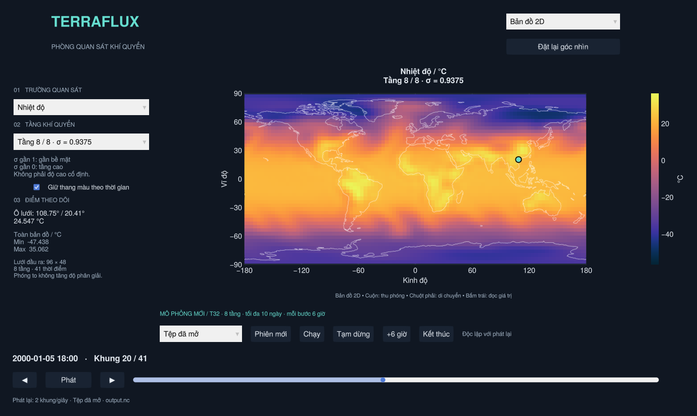

# TerraFlux

Trình quan sát khí quyển từ dữ liệu mô phỏng SpeedyWeather. Bản V1 hiện tại mở dữ liệu NetCDF đã ghi, không chạy lại mô phỏng khi kéo thời gian.



## Mở trên Windows

1. Cài **Julia 1.13.3**, bảo đảm lệnh `julia --version` chạy được trong Terminal. Có thể cài qua [Juliaup](https://julialang.org/downloads/).
2. Tải/clone toàn bộ repo về máy, giải nén nếu dùng ZIP.
3. Bấm đúp **`Open_TerraFlux.bat`**.

Lần đầu cần Internet để Julia cài thư viện và biên dịch; cửa sổ dòng lệnh sẽ hiện tiến trình. Những lần sau dùng lại bộ nhớ đệm. Giao diện cần driver đồ họa hỗ trợ **OpenGL 3.3**. Nếu mở lỗi, cửa sổ dòng lệnh sẽ giữ lại thông báo để kiểm tra.

Mặc định mở `run_0001/output.nc` đi kèm repo. Có thể kéo thả một tệp `output.nc` khác lên `Open_TerraFlux.bat` để mở tệp đó. Đường dẫn chứa dấu cách được hỗ trợ. Tệp cần theo cấu trúc SpeedyWeather của dự án: `lon`, `lat`, `layer`, `time`, `temp`, `u`, `v`, `humid`, `mslp`.

Linux/macOS, với Julia trong PATH:

```sh
./open_terraflux.sh
# Hoặc chọn dữ liệu khác:
./open_terraflux.sh /path/to/output.nc
```

Từ Terminal, trên mọi hệ điều hành:

```sh
julia --project=. viewer.jl --setup
julia --project=. viewer.jl /path/to/output.nc
```

## Chạy mô phỏng từ giao diện

Dải **MÔ PHỎNG MỚI** nằm ngay phía trên phần phát lại:

1. Bấm **Phiên mới** để khởi tạo một thí nghiệm khí quyển T32, 8 tầng từ điều kiện mặc định của SpeedyWeather. Đây là phiên độc lập, không tiếp tục từ khung dữ liệu đang xem.
2. Chờ trạng thái **Đã tạm dừng**, rồi bấm **+6 giờ** để tính một bước, hoặc **Chạy** để tính liên tiếp.
3. **Tạm dừng** yêu cầu dừng sau mốc 6 giờ đang tính. Trong lúc chờ, giao diện báo lệnh chưa xử lý; nó không hủy nửa chừng một bước.
4. **Kết thúc** đóng phiên sau mốc đang tính. Sau đó có thể tạo phiên khác.

Các nút này điều khiển **phép tính vật lý**. Nút **Phát/Dừng** và thanh thời gian bên dưới chỉ phát lại dữ liệu đã ghi. Mốc mới tự xuất hiện trên bản đồ/địa cầu sau mỗi 6 giờ tính xong; khi xem nguồn phiên đang chạy, giao diện theo mốc mới nhất. Có thể tạm dừng để xem lại các mốc cũ. Menu nguồn cho phép trở về **Tệp đã mở** trong khi phiên tiếp tục tính.

- Bước tính đầu tiên của mỗi tiến trình phiên mới có thể mất vài phút để Julia biên dịch. Cửa sổ vẫn xoay bản đồ/địa cầu và xem dữ liệu đã có được trong thời gian này. Phiên mới có thể cần Internet để SpeedyWeather tải dữ liệu điều kiện biên.
- Mỗi phiên hiện giới hạn **10 ngày**, giữ cấu hình T32/8 tầng như bản mô phỏng đã kiểm tra. Cần mở dữ liệu mẫu cùng lưới để dùng điều khiển trực tiếp.
- SpeedyWeather chưa tính chẩn đoán nhiệt độ sát bề mặt cần cho **áp suất quy mực biển ở mốc khởi tạo**. Giao diện phiên mới ghi rõ trường này thiếu dữ liệu tại mốc 0, không thay bằng giá trị giả. Các trường trạng thái và mọi đầu ra tại mốc đã tính từ 6 giờ trở đi đều được kiểm tra hữu hạn; phát hiện mất ổn định sẽ dừng và báo lỗi.
- Phiên lưu ở `sessions/session_…/`: cấu hình `config.toml`, nhật ký lệnh `commands/`, trạng thái `status.toml`, lỗi/tiến trình `worker.log`, và các thư mục `run_…` chứa NetCDF cùng `restart.jld2`. `sessions/` không được đưa vào Git. NetCDF thô của đoạn đầu vẫn chứa chẩn đoán áp suất khởi tạo chưa hợp lệ; dùng các mốc từ 6 giờ để phân tích áp suất.
- Khi đóng cửa sổ, ứng dụng yêu cầu tiến trình mô phỏng kết thúc; nếu nó còn bận sau 3 giây thì dừng tiến trình đó. Những đoạn đã hoàn tất được giữ lại; đoạn đang tính có thể chưa hoàn chỉnh. Giao diện chỉ nạp các tệp đã đóng và vượt qua kiểm tra. Chưa có chức năng khôi phục phiên từ restart trong giao diện.
- Mô hình được chạy nối tiếp bằng các lời gọi `run!` 6 giờ được thư viện hỗ trợ. Bộ kiểm tra xác nhận đồng hồ liên tục và trạng thái tiến triển; chưa khẳng định kết quả trùng bit với một lời gọi dài 10 ngày.


## Địa cầu 3D

Chọn **Địa cầu 3D** trong menu ở góc trên bên phải; chọn **Bản đồ 2D** để quay lại. Hai chế độ dùng chung trường, tầng, thời gian, điểm theo dõi và thang màu.

- Giữ/kéo chuột trái để xoay, cuộn chuột để thu/phóng. Camera luôn ở ngoài mặt cầu.
- Bấm rồi thả tại chỗ trên địa cầu để đọc ô lưới gần nhất ở mặt đang nhìn. Kéo để xoay hoặc bấm vào khoảng trống không đổi điểm theo dõi.
- Nút **Đặt lại góc nhìn** đưa địa cầu về hướng Đông Nam Á; ở bản đồ 2D nút này khôi phục phạm vi toàn cầu.
- Các ô lưới được tô cùng giá trị với bản đồ 2D, không làm mịn màu để tạo thêm chi tiết vật lý. Hai cực dùng giá trị của hàng lưới gần nhất. Mặt cầu chỉ là cách trình bày tầng đang chọn, không biểu diễn độ cao thật của tầng sigma.
- Đường bờ lấy từ Natural Earth; các đường kinh/vĩ tuyến giúp định hướng. Không cần tải thêm dữ liệu địa cầu.


## Sử dụng

- **Trường quan sát:** nhiệt độ (°C), tốc độ gió hoặc từng thành phần gió (m/s), độ ẩm riêng (g/kg), áp suất quy về mực biển (hPa).
- **Tầng:** chọn một trong 8 tầng của dữ liệu mẫu. Sigma gần 1 là gần bề mặt, gần 0 là tầng cao. Đây không phải độ cao cố định. Áp suất quy mực biển là trường 2D, không thay đổi khi chọn tầng.
- **Thời gian:** kéo thanh hoặc bấm nút tiến/lùi. Nút Phát/Dừng phát lại 2 khung/giây, dừng ở khung cuối. Dữ liệu mẫu có 41 khung cách nhau 6 giờ trong 10 ngày. Thời gian là thời gian vật lý của mô hình.
- **Đọc tại điểm:** bấm trái vào bản đồ. Dấu chấm và bảng bên trái chỉ tọa độ/giá trị tại ô lưới gần nhất; điểm được giữ khi đổi tầng, trường và thời gian. Không nội suy giá trị tại vị trí chuột.
- **Thang màu:** mặc định giữ cùng thang cho toàn bộ thời gian của trường và tầng đang chọn. Bỏ chọn để tự co giãn theo từng khung. Gió u/v dùng thang đối xứng quanh 0.
- **Bản đồ:** cuộn để thu/phóng, giữ chuột phải để di chuyển; Ctrl + bấm trái để đặt lại. Phóng to không tăng độ phân giải vật lý.

Phần bản đồ dùng kinh độ −180…180°, vĩ độ −90…90°, đường bờ Natural Earth được đóng gói cùng GeoMakie. Nhiệt độ trong NetCDF mẫu đã là °C, không trừ Kelvin thêm lần nữa. Độ ẩm kg/kg được đổi sang g/kg. Dữ liệu thiếu được bỏ qua khi tính thang màu/thống kê, hiện trong bảng điểm dưới dạng “Thiếu dữ liệu”.

## Cấu trúc

- `src/data.jl`: đọc/kiểm tra NetCDF, chuẩn hóa tọa độ và đơn vị, chọn trường/tầng/thời gian.
- `src/viewer.jl`: giao diện GLMakie, bản đồ/địa cầu, các điều khiển và phát lại.
- `src/globe.jl`: hình học từng ô địa cầu, chuyển tọa độ và chọn mặt cầu bằng tia nhìn.
- `src/live.jl`, `src/live_worker.jl`: điều khiển tiến trình mô phỏng riêng và công bố các đoạn dữ liệu hoàn tất.
- `viewer.jl`: điểm khởi chạy, nhận đường dẫn dữ liệu.
- `main.jl`, `check_model.jl`: mô phỏng và kiểm tra trạng thái hiện có.
- `note1.txt`: mục tiêu và lộ trình phát triển.

Chỉnh trạng thái, khôi phục phiên trong giao diện và so sánh A/B là các mốc tiếp theo; chưa có trong bản này.

## Kiểm tra

Kiểm thử tọa độ, chuyển đổi đơn vị, chọn điểm, thang màu và đối chiếu trực tiếp dữ liệu mẫu:

```sh
julia --project=. test/runtests.jl
```

Kiểm thử giao diện 2D/3D: đổi trường/tầng/thời gian, chọn điểm, xoay, thu/phóng, đặt lại camera (cần màn hình và OpenGL; trên Linux có thể dùng Xvfb):

```sh
julia --project=. test/viewer_smoke.jl
```

Kiểm thử tích hợp với mô hình thật (lần đầu cần thời gian biên dịch và dữ liệu điều kiện biên):

```sh
julia --project=. test/live_smoke.jl
julia --project=. test/live_cleanup.jl
# Kiểm tra nút giao diện với một worker thật, cần màn hình/OpenGL:
julia --project=. test/live_viewer_smoke.jl
```
