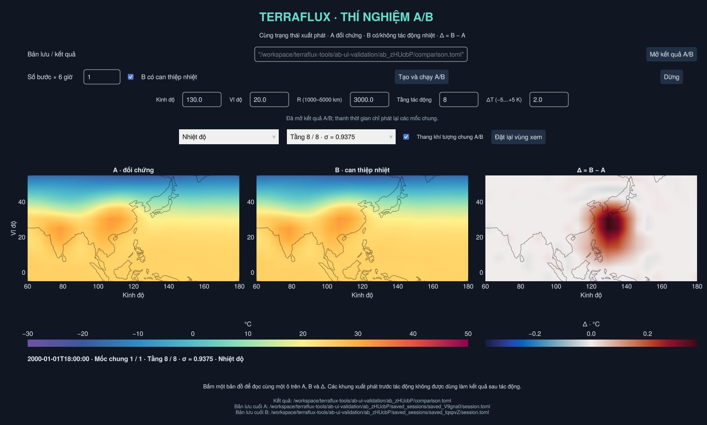

# Thí nghiệm A/B từ một trạng thái đã lưu

Hai nhánh xuất phát từ **cùng checkpoint, cấu hình, đồng hồ và RNG**:

- **A** giữ trạng thái xuất phát và không nhận tác động mới.
- **B** nhận một tác động nhiệt hoặc xoáy lý tưởng theo cấu hình, hoặc không nhận tác động mới
  nếu bỏ chọn checkbox để kiểm tra cặp đối chứng.
- **Δ = B − A** so sánh cùng trường, tầng, ô và thời gian vật lý.

Đây là mốc đầu của V3. Hai loại tác động một lần hiện có là nhiệt trên một
tầng khí quyển ([THERMAL_EXPERIMENTS.md](THERMAL_EXPERIMENTS.md)) và xoáy áp
thấp/gió/lõi ấm toàn cột ([IDEALIZED_VORTEX.md](IDEALIZED_VORTEX.md)).



## Mở và chạy

1. Trong viewer, tạo phiên live, tính ít nhất **+6 giờ**, tạm dừng và **Lưu phiên**.
   Nên lưu trước khi can thiệp để có một mốc đối chứng phù hợp. Bản lưu còn
   tác động chờ mốc mới bị từ chối; có thể hoàn tác hoặc tính tiếp rồi lưu lại.
2. Bấm **Thí nghiệm A/B** ở dải lưu phiên, hoặc mở **Compare_Experiments.bat**.
   Có thể kéo `session.toml` lên file `.bat` để điền sẵn đường dẫn.
3. Dán đường dẫn `session.toml` hoặc thư mục bản lưu. Chọn **1–40 bước × 6 giờ**,
   trong giới hạn thời lượng còn lại của bản lưu. Mặc định 4 bước = 1 ngày.
4. Bật checkbox tác động, chọn **B: nhiệt một tầng**, nhập kinh/vĩ độ, R, tầng và ΔT. R 1000–5000 km;
   ΔT khác 0 trong −5…+5 K; tầng phải có trong bản lưu. Hoặc bỏ chọn để cho cả
   hai nhánh tiến triển mà không chèn tác động mới.
5. Bấm **Tạo và chạy A/B**. Worker kiểm tra/sao chép bản lưu rồi tính **A trước,
   B sau**, mỗi đoạn 6 giờ. Giao diện báo giai đoạn và số bước thật của từng nhánh.
6. Khi có mốc mới chung, xem ba bản đồ. Chọn trường/tầng và kéo thời gian;
   cuộn/kéo một bản đồ sẽ đổi vùng xem của cả ba. Bấm một bản đồ để đọc cùng
   ô lưới trên A, B và Δ. **Đặt lại vùng xem** đưa cả ba về toàn cầu.

Linux/macOS:

```sh
./compare_experiments.sh '/path/to/saved_abc/session.toml'
# Hoặc chạy trực tiếp với thư viện đã cài:
julia --threads=2 --project=. compare_experiments.jl '/path/to/session.toml'
```

Hai nhánh chạy lần lượt trong các tiến trình CPU riêng, do một worker điều
phối; chỉ một mô hình được tính tại một thời điểm. Bước đầu vẫn có thể mất vài phút biên dịch. Lựa chọn trên form được cố
định khi tạo; chỉnh ô nhập trong lúc chạy chỉ chuẩn bị cho lần tạo sau.
Không có tạm dừng/tiếp tục job A/B giữa chừng trong bản này. **Dừng**/đóng cửa
sổ dừng worker; những đoạn đã đóng và nhật ký được giữ để kiểm tra.

## Cách đọc kết quả

Chỉ hiện **mốc sau xuất phát mà cả hai nhánh đã tính xong**. Chưa có B không
có nghĩa B bằng 0; không lấy mốc khác thời gian, không nội suy để ép ghép.
Khung xuất phát của B có thể là trước/sau chèn nhiệt tùy đầu ra thư viện;
giao diện bỏ khung này và chỉ so sánh các endpoint mới sau 6 giờ trở đi.

A và B dùng **cùng thang màu**. Mặc định là thang khí tượng của viewer;
bỏ chọn để dùng min/max chung tại mốc đang xem. Δ có thang đối xứng quanh 0,
giữ cùng biên qua các mốc đã có của trường/tầng đang chọn; khi có dữ liệu mới,
biên có thể tăng. Ô thiếu ở một nhánh khiến chênh lệch tại đó cũng thiếu.

- Nhiệt độ: Δ theo °C, bằng chênh lệch K.
- Tốc độ gió: km/h; Δ là `|v_B| − |v_A|`, không phải `|v_B − v_A|`.
- u/v: m/s, so sánh từng thành phần.
- Độ ẩm riêng: g/kg. RH: chênh lệch **điểm phần trăm**, không phải phần trăm
  tương đối. RH vẫn cần áp suất bề mặt thật, không dùng MSLP thay thế.
- MSLP: hPa, không phụ thuộc tầng quan sát.

“A đối chứng” có nghĩa không có **tác động mới trong cặp này**. Cả hai vẫn
kế thừa mọi biến đổi đã có trong checkpoint, bao gồm can thiệp từ trước.
Đổi màu/zoom/trường quan sát không làm mô hình tiến thêm hay sửa trạng thái.

## Thư mục, mở lại và tính tiếp

Mỗi lần tạo có thư mục riêng `sessions/comparisons/ab_…/`:

| Tệp/thư mục | Ý nghĩa |
| --- | --- |
| `comparison.toml` | Cấu hình, thời điểm xuất phát, SHA checkpoint, giai đoạn, kết quả từng nhánh và checksum |
| `baseline/` | Bản sao đã kiểm tra của bản lưu nguồn; worker khôi phục cả hai từ đây |
| `session_…/` | Workspace riêng của A/B, lịch sử, NetCDF và sự kiện nhiệt của B |
| `saved_sessions/` | Bản lưu cuối từng nhánh đã tính xong; đường dẫn ghi trong `archive_a`, `archive_b` |
| `worker.log`, `session_…/worker.log` | Nhật ký điều phối và nhật ký/stacktrace riêng từng mô hình |

**Mở kết quả A/B** nhận `comparison.toml` hoặc thư mục `ab_…`; thao tác này
chỉ đọc dữ liệu, không khởi động physics. Có thể kéo `comparison.toml` lên
`Compare_Experiments.bat`. Để chuyển kết quả, giữ **cả thư mục `ab_…`**; các
đường dẫn đầu ra/bản lưu cuối là tương đối. Đường dẫn nguồn tuyệt đối trong
metadata chỉ ghi nguồn gốc, không cần để xem kết quả đã tạo xong.

Đường dẫn `archive_a`/`archive_b` trỏ tới `session.toml` cuối từng nhánh. Mở
bằng `Open_TerraFlux.bat` để xem đầy đủ lịch sử hoặc tính tiếp nếu vẫn còn
thời lượng; chúng cũng dùng được làm gốc cho cặp A/B mới. Nếu dừng/lỗi, chỉ
nhánh đã hoàn tất giai đoạn lưu mới có archive; một số đoạn chung vẫn xem được.

`comparison_setup.log` cạnh launcher giữ lỗi khởi động; chỉ launcher mở file
và chuyển hướng stdout/stderr, GUI không mở lại handle ghi trên Windows.
Các thư mục phiên và log cục bộ bị Git bỏ qua.

## Giới hạn và kiểm chứng

Physics dùng CPU, cùng phiên bản Julia/SpeedyWeather như bản lưu. Chưa có
can thiệp ẩm/gió, tác động duy trì, đối chiếu Storm Tracker hoặc biểu đồ vùng
trong cửa sổ A/B. Viewer vẫn nạp dữ liệu vào RAM. Bản sao nguồn, hai workspace
và hai bản lưu cuối cần thêm đĩa; độ phân giải/thời lượng lớn làm tăng chi phí.

Kiểm tra mô hình thật trên Linux T21/8 tầng: cặp không tác động tiến hai đoạn
6 giờ, đối chiếu mọi trường/tầng cao-thấp; cặp B được làm nóng tiến một đoạn,
kiểm tra nhật ký, thời gian và chênh lệch. Kết quả mở được sau khi chuyển thư
mục; checksum từ chối tệp đổi. GUI được kiểm tra bằng sự kiện chuột thật.
Launcher Windows được kiểm tra nội dung; chưa chạy Windows trực tiếp.

```sh
julia --project=. test/comparison_values.jl
# Dùng một bản lưu sạch, còn ít nhất hai đoạn 6 giờ; ví dụ bản lưu cuối
# từ test/session_resume.jl ở T21/8 tầng, không dùng archive còn pending_edit:
julia --threads=2 --project=. test/comparison_model.jl /path/to/session.toml /path/to/new-validation-dir
julia --threads=2 --project=. test/comparison_cancel.jl /path/to/session.toml
# Cần màn hình/OpenGL:
julia --threads=2 --project=. test/comparison_viewer.jl /path/to/session.toml
julia --threads=2 --project=. test/comparison_reopen.jl /path/to/comparison.toml
```

Tách nhánh này kiểm chứng luồng từng đoạn 6 giờ của TerraFlux. Chưa khẳng định
mọi backend/tham số vật lý của thư viện có thể khôi phục, hoặc mọi lựa chọn
can thiệp/độ phân giải đều ổn định.
