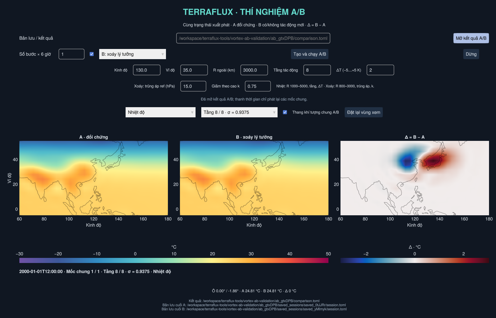

# Khởi tạo xoáy lý tưởng hóa

**Khởi tạo xoáy** chèn một áp thấp có gió quay và lõi ấm liên hệ với nhau vào
phiên live. Đây là mẫu nhiễu động khí quyển để thử nghiệm, **chưa phải bộ tạo
bão nhiệt đới đã kiểm định**. Không tự gán TD/TS/TY hay cấp SSHWS.



## Sử dụng

1. Mở `Open_TerraFlux.bat`, tạo phiên live và tính ít nhất **+6 giờ**. Tạm dừng,
   chọn nguồn **Phiên mô phỏng** và mốc cuối. Nên **Lưu phiên** trước khi chèn.
2. Bấm **Khởi tạo xoáy** ở đầu cửa sổ. Chọn tâm trên bản đồ/địa cầu hoặc bấm
   **Đặt tâm / R gợi ý theo lưới**. Vòng xem trước là bán kính ngoài của mẫu.
3. Nhập R, trũng áp tham chiếu và k. Gió/lõi ấm được suy ra từ các đầu vào đó;
   không có nút đặt riêng Vmax, áp suất tâm và ΔT thành ba số độc lập.
4. Bấm **Chèn xoáy một lần**. Worker kiểm tra lưới và trạng thái, lưu checkpoint
   trước/sau, ghi các số đo sau chiếu phổ. Đóng mở bảng không làm mô hình tiến lên.
5. **Hoàn tác tác động gần nhất** khôi phục toàn bộ trạng thái trước thao tác,
   nếu chưa tính tiếp. Hoặc bấm **+6 giờ/Chạy** để quan sát sự phát triển thật.

Các khung NetCDF cũ giữ nguyên. Sau khi chèn, bản đồ vẫn đọc hồ sơ trước tác
động; mốc mới sau +6 giờ mới cho thấy phản ứng. Lưu/mở phiên giữ được trạng
thái đang chờ và quyền hoàn tác. Hoàn tác một cấp áp dụng cho tác động gần
nhất, dù đó là nhiệt một tầng hay xoáy, không phải tua ngược mọi lịch sử.

| Đầu vào | Phạm vi / ý nghĩa |
| --- | --- |
| Tâm | Kinh độ −180…180°, \|vĩ độ\| 10…40°; quay thuận theo bán cầu |
| R | 800–3000 km, bán kính ngoài danh nghĩa; không phải R34/bán kính mắt bão |
| Trũng áp tham chiếu | 5–25 hPa trên nền tham chiếu 1000 hPa; không phải MSLP tâm đặt trước |
| k | 0.5–1.5; k lớn làm gió suy giảm nhanh hơn theo cao, đồng thời tăng phần ấm gần đáy |

R còn phải nhỏ hơn 80% khoảng cách tâm tới xích đạo và đủ lớn so với lưới
native. Không tự cắt R/Δp để chấp nhận một đầu vào sai. Vùng nhỏ trên T21/T32
có thể bị từ chối; zoom/mượt ảnh không giải quyết được thiếu độ phân giải.

Gợi ý ban đầu:

- **T32:** mẫu rộng R 3000 km, tâm khoảng 130°E/35°N, Δp_ref 15 hPa, k=0.75.
- **T63/T85:** thử R 1700 km, tâm khoảng 130°E/20°N. Có thể tạo dữ liệu T63
  bằng `Create_Simulation.bat`, mở kết quả rồi tạo phiên live cùng lưới.

Đây là các cấu hình thí nghiệm, không bảo đảm xoáy mạnh lên hay trở thành bão.
Không tự đổi SST, độ ẩm hay sơ đồ đối lưu để ép xuất hiện bão. Khả năng biểu
diễn bão nhiệt đới vẫn bị giới hạn bởi độ phân giải và vật lý của SpeedyWeather.

## Cấu trúc tham chiếu

Mẫu được xây dựng trong khí quyển **đẳng nhiệt ảo, mặt đất phẳng**, với
`Tv_ref=300 K`, `p_ref=1000 hPa`, mặt phẳng f có `f0=2Ω sin(lat_tâm)`.
Đặt `H=Rd*Tv_ref/g`, `y=z/H`, khoảng cách cung cầu r và:

```
x = r/R
w = (1-x)^4 (1+4x),             0 ≤ x < 1; w=0 ngoài R
A = -log(1 - Δp_ref/1000)
ln(p/p_ref) = -y - A*w*exp(-k*y)
δ ln(ps) = -A*w
```

Tại tầng sigma, giải phương trình đơn điệu:

```
y - A*w*(1-exp(-k*y)) = -ln(sigma)
Tv = Tv_ref / (1-A*w*k*exp(-k*y))
a_r = -Rd*Tv*A*exp(-k*y)*dw/dr
V²/r + |f0|*V = a_r
```

Đây là quan hệ thủy tĩnh và cân bằng gradient gió của **mẫu tham chiếu**.
Đổi δTv thành δT với độ ẩm hiện có qua hệ số nhiệt độ ảo của mô hình; q không
bị gán giá trị mới. Gió đi theo tiếp tuyến các vòng tròn trên mặt cầu, đổi chiều
theo bán cầu, hữu hạn ở tâm và bằng 0 ngoài R. Trường suy giảm theo cao thay
vì chỉ thay một tầng. Áp suất đầu vào là log áp suất bề mặt thật, không sửa MSLP.

Mẫu này được **cộng vào khí quyển đang có**. Nền thực có dòng chảy, phân tầng,
địa hình, ẩm và f thay đổi theo vĩ độ; cộng thêm nhiễu không làm toàn trạng thái
trở thành nghiệm cân bằng. Các tương tác, sóng điều chỉnh và sự suy yếu/mạnh lên
sau đó do mô hình tính. Đây cũng không phải cấu trúc mắt/thành mắt bão được giải.

## Chiếu phổ và kiểm tra

Nhiễu được tạo trên lưới native rồi chiếu sang phổ. Gió được chuyển thành
nhiễu độ xoáy trong bộ đệm riêng; cộng cùng nhiễu vào cả hai bộ đệm leapfrog.
Giữ phân kỳ nền: mẫu tiếp tuyến là phi phân kỳ, phần nhiễu phân kỳ số sau
chiếu không được chèn. Không dùng phép cộng curl bán kính khác 1 của thư viện
trực tiếp lên trường nền, vì cách chia bán kính sẽ làm đổi cả trường đã có.

Kiểm tra trước/sau gồm:

- Ít nhất 8 điểm native trong r<R/2 và R≥7 lần khoảng cách ô ước tính từ
  diện tích native trung bình trong vùng đó.
- Tái dựng gió từ nhiễu xoáy đã chiếu; sai số L2 tương đối có trọng số diện
  tích so với gió mẫu phải ≤0.35. Nếu không đạt, từ chối và hoàn tác.
- Hai bộ đệm hữu hạn, T trong 100–400 K, ps trong 100–1200 hPa.
- Khôi phục checkpoint nếu áp dụng/ghi hậu trạng thái thất bại. Khi tính tiếp,
  các kiểm tra hữu hạn/mất ổn định của live vẫn được giữ.

Ngưỡng lưới/L2 là hàng rào thử nghiệm, không phải bằng chứng độ chính xác
khí tượng. Chiếu phổ có thể tạo đuôi ngoài vòng R và thay đổi cực trị. Nhật ký
ghi Vmax tái dựng, sai số gió, Δps và ΔT thực sau chiếu, không coi chúng bằng
các cực trị lý tưởng trong preview.

Thao tác này không bảo toàn khối lượng: giảm ps làm thay đổi khối lượng cột
khí, và q giữ nguyên vẫn có thể đổi tổng khối lượng hơi nước. Nhật ký ghi:

```
ΔM = sum(area * (ps_after-ps_before)) / g
ΔM_water = sum(area * (ps_after-ps_before) * sum(Δsigma*q_before)) / g
ΔH_dry = cp/g * sum(area * (ps_after*sum(Δsigma*T_after)
                         -ps_before*sum(Δsigma*T_before)))
```

ΔH là ước lượng thay đổi enthalpy khô của cột, không phải tổng năng lượng (chưa gồm
động năng/thế năng/nhiệt ẩn). Không gọi thao tác này là tái phân phối bảo toàn
khối lượng/năng lượng hoặc liên tục duy trì một xoáy.

## Thí nghiệm A/B và mã nguồn

Mở **Compare_Experiments.bat**, chọn **B: xoáy lý tưởng**. A không nhận tác
động mới, B nhận mẫu từ cùng bản lưu. Nhập tâm/R/trũng áp/k; các ô tầng/ΔT
chỉ dùng khi chọn nhiệt một tầng. Bản đồ B−A cho thấy phản ứng tại cùng mốc.
Các bản lưu A/B cũ mặc định vẫn được hiểu là can thiệp nhiệt.

`src/vortex_profiles.jl` chứa công thức/giới hạn, `vortex_model.jl` xử lý phổ
và số đo, `vortex_panel.jl` là preview/UI. Nhật ký nằm trong `edits/…/event.toml`
với action `vortex`; `before.jld2`/`after.jld2` giữ đầy đủ trạng thái/đồng hồ/RNG.
`undo_edit` là lệnh hoàn tác chung; `undo_thermal` vẫn dùng được cho tương thích.

Đã kiểm tra mô hình thật trên Linux: T32/8 tầng (R 3000 km, 35°N) và T63/8
tầng (R 1700 km, 20°N), cùng Δp_ref 15 hPa/k=0.75. Cả hai qua kiểm tra chiếu
phổ, khôi phục checkpoint và tính tiếp 6 giờ. GUI kiểm tra chèn/lưu/hoàn tác,
menu ẩn và 2D/3D; A/B kiểm tra đối chiếu hai nhánh. Chưa chạy trực tiếp Windows.

```sh
julia --project=. test/vortex_profiles.jl
julia --threads=2 --project=. test/vortex_model.jl /path/to/new-test-directory
# T63, tự tạo baseline (dấu -):
julia --threads=2 --project=. test/vortex_model.jl /path/to/new-T63-directory - 63
# Dùng session.toml sạch được bài kiểm tra in ra, cần màn hình/OpenGL:
julia --threads=2 --project=. test/vortex_viewer.jl /path/to/session.toml
```
