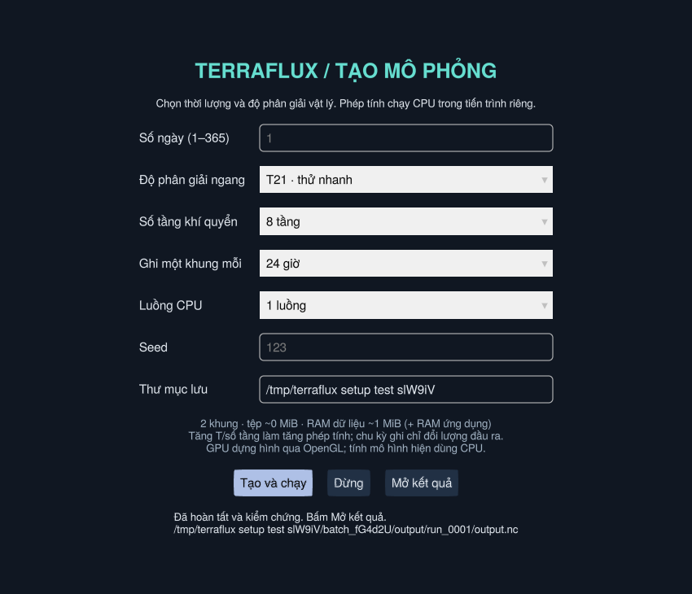

# Tạo phiên mô phỏng trên máy

Windows: bấm đúp **Create_Simulation.bat**. Linux/macOS:
`./create_simulation.sh`. Hoặc chạy `julia --threads=2 --project=. simulation_setup.jl --setup`.
Lần đầu cần Internet để cài thư viện/dữ liệu điều kiện biên và thời gian biên dịch.



Chọn số ngày rồi bấm **Tạo và chạy**. Phép tính dùng tiến trình riêng; form vẫn
phản hồi. Khi trạng thái báo đã hoàn tất/kiểm chứng, bấm **Mở kết quả** để mở
viewer. Không phải tự sửa Julia hoặc chạy từng lệnh. Mỗi lần tạo dùng thư mục
mới dưới `sessions/generated/` (có thể đổi đường dẫn), không ghi đè bộ đang xem.

| Tham số | Lựa chọn và tác dụng |
| --- | --- |
| Số ngày | Số nguyên 1–365; quyết định thời lượng vật lý |
| Độ phân giải ngang | T21/T32/T63/T85; tăng T để mô phỏng chi tiết hơn, tăng chi phí |
| Tầng | 8/16/24/32 tầng sigma; tăng chi tiết thẳng đứng và RAM/phép tính |
| Chu kỳ ghi | 1/3/6/12/24 giờ; độ dày khung lưu, không phải bước tích phân |
| Luồng CPU | 1/2/4/8; chọn phù hợp CPU, nhiều luồng không bảo đảm nhanh hơn |
| Seed | Điều khiển khởi tạo ngẫu nhiên; không đổi bộ tham số vật lý khác |

Gợi ý: T21/8 tầng/1 ngày để thử; T32/8 tầng/60 ngày giống độ phân giải bộ mẫu;
T63/16 tầng nếu muốn thử lưới tốt hơn. Đây là các cấu hình khởi điểm, chưa có
benchmark tổng quát cho từng máy. Không đảm bảo 365 ngày/T85/32 tầng sẽ vừa RAM
hay ổn định. Mất ổn định sẽ báo lỗi, không quảng bá tệp dở là kết quả hoàn tất.

Ước lượng tệp/RAM dữ liệu dựa trên bộ T32/8 tầng/60 ngày/6 giờ hiện có, chỉ là
xấp xỉ theo số ô/tầng/khung. **RAM ứng dụng, mô hình, thư viện và bộ nhớ đệm là
phần bổ sung**. Viewer hiện nạp toàn tệp vào RAM; tạo chuỗi rất dài/ghi quá dày
có thể làm viewer thiếu RAM. Các cấu hình khí quyển đều là thí nghiệm lý tưởng
PrimitiveWetModel, không trở thành dự báo thực tế nhờ tăng T.

Muốn nối track, nên ghi mỗi ≤12 giờ: bộ liên kết hiện từ chối ghép hai mốc cách
nhau >12 giờ. Chọn 24 giờ vẫn xem được trường nhưng track có thể tách ID.

## Dừng và kết quả

**Dừng** hoặc đóng form sẽ dừng tiến trình do form đó tạo, giữ nhật ký/đầu ra
dở để kiểm tra. Bản này chưa tiếp tục được job dừng giữa chừng từ form. Chỉ
hiện **Mở kết quả** thành công khi toàn bộ đầu ra đã qua kiểm chứng.

Mỗi thư mục `batch_*` có:

- `config.toml`: ngày/T/tầng/chu kỳ ghi/luồng/seed.
- `worker.log`, `status.toml`: nhật ký và trạng thái.
- `output/experiment.toml`: manifest nguồn gốc, thời lượng, số khung, seed,
  Julia, CPU/luồng, thời gian tính và kết quả kiểm chứng.
- `output/run_0001/output.nc`: dữ liệu cho viewer; các đầu ra khác của
  SpeedyWeather, bao gồm restart nếu thư viện ghi, được giữ cùng thư mục.

MSLP/áp suất bề mặt tại mốc khởi tạo vẫn được đánh dấu thiếu như bộ mẫu;
không thay bằng số giả. Kiểm tra từng khung temp/u/v/humid hữu hạn, áp suất
hữu hạn sau khởi tạo, đồng hồ/số khung chính xác và trạng thái cuối T>0 K.

Dải live trong viewer vẫn chọn 10/30/60 ngày, mỗi bước 6 giờ, tạo phiên mới
từ điều kiện mặc định. Khi mở kết quả form có metadata, live kế thừa T/số tầng
để giữ cùng lưới; **không tiếp tục trạng thái cuối của thí nghiệm batch**.

Đã chạy thật và kiểm chứng trên cloud: T63/16 tầng/1 ngày/6 giờ (5 khung),
và T21/8 tầng/1 ngày/24 giờ (2 khung) từ chính form. Kiểm tra live cũng đã
mở kết quả T63/16 tầng, tạo phiên cùng cấu hình và tính thêm hai mốc 6 giờ. Các script mở Windows được
kiểm tra nội dung; chưa chạy Windows trong môi trường Linux này.


Có thể chạy hồi quy live với tệp chất lượng khác đã tạo (Linux/macOS):

```sh
TERRAFLUX_TEST_DATA=/path/to/output.nc julia --threads=2 --project=. test/live_viewer_smoke.jl
```
