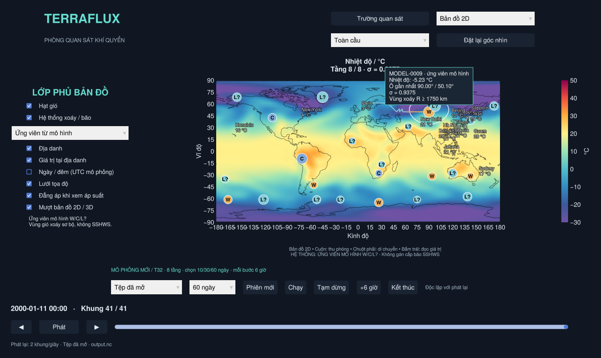
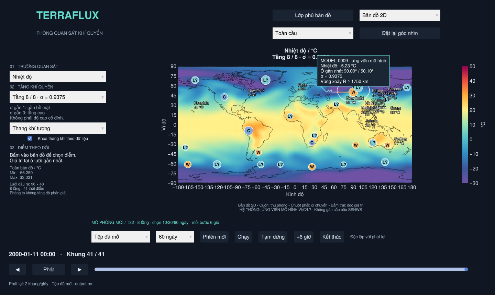
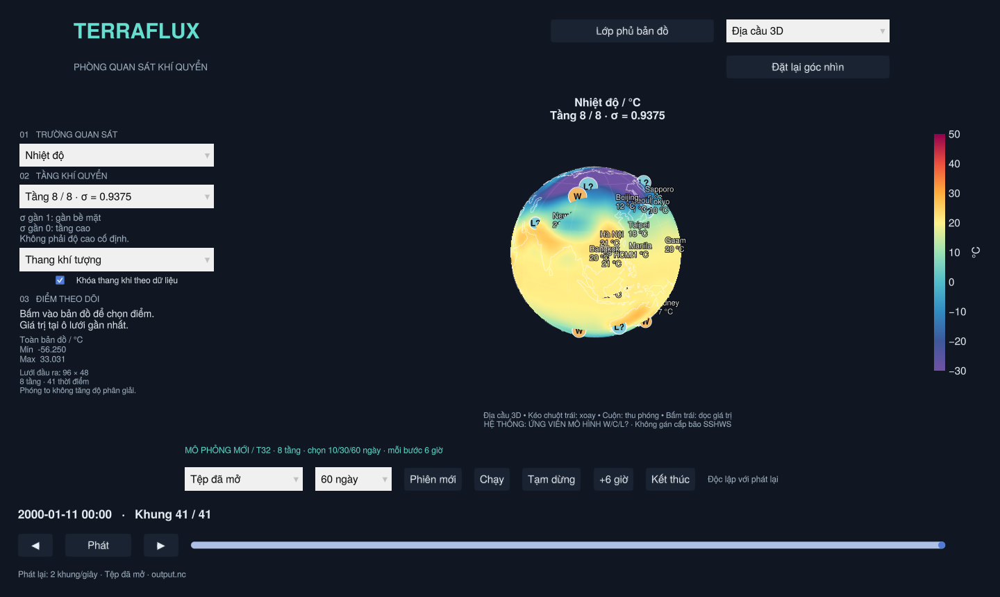

# Lớp phủ, đọc giá trị và kích thước vùng xoáy

Trong **Bản đồ 2D** hoặc **Địa cầu 3D**, bấm **Lớp phủ bản đồ** ở đầu cửa sổ.
Bấm **Trường quan sát** để trở về bảng chọn trường/tầng. Hai bảng thay nhau
nhận chuột; Storm Tracker vẫn có bảng điều khiển riêng.

| Lớp | Nội dung |
| --- | --- |
| Hạt gió | u/v đúng tầng, nguồn và mốc đang xem; hoạt động cả khi tạm dừng phát lại |
| Hệ thống xoáy / bão | Chọn riêng ứng viên mô hình W/C/L? hoặc kịch bản MINH HỌA |
| Địa danh | Một tập địa danh tham chiếu, không phải dịch vụ tra cứu địa danh đầy đủ |
| Giá trị tại địa danh | Giá trị ô gần nhất của trường/tầng/thời điểm đang chọn |
| Ngày / đêm | Xấp xỉ vị trí Mặt Trời từ ngày và giờ UTC của **mô phỏng** |
| Lưới tọa độ | Kinh/vĩ tuyến 2D và 3D |
| Đẳng áp | Đường 4 hPa khi xem áp suất trên 2D |
| Mượt bản đồ 2D / 3D | Nội suy hình vẽ; không thay đổi dữ liệu vật lý |

## Rê chuột

Di chuột trên bản đồ/mặt cầu để đọc tên trường, giá trị, đơn vị, tọa độ ô gần
nhất và sigma khi phù hợp. Popup theo trường/tầng/thời điểm và tệp/live đang
xem; dữ liệu thiếu hiện **Thiếu dữ liệu**. Đây là giá trị ô mô hình, không phải
giá trị nội suy mượt tại con trỏ hay nhiệt độ 2 m/gió 10 m mặc định.

Khi bật lớp hệ thống, rê trong vùng xoáy có bán kính đã chẩn đoán sẽ thêm ID,
nguồn, bán kính và làm nổi vòng phạm vi/quỹ đạo đã xảy ra. Nếu nhiều vùng chồng
nhau, chọn vùng có khoảng cách tương đối tới tâm nhỏ nhất. Khi chưa có bán kính,
vùng bắt chuột gần tâm 200 km chỉ phục vụ chọn biểu tượng, không biểu diễn phạm
vi bão. Rê chuột không đổi điểm đã ghim hoặc đồng hồ. Trên 3D, phần ngoài mặt
cầu không có số liệu; mở menu/kéo chuột sẽ ẩn popup.

Nguồn hệ thống luôn ghi dưới bản đồ, kể cả khi đóng bảng lớp phủ. Lớp phủ
giới hạn 256 icon đồng thời; nếu vượt sẽ báo số tâm bị ẩn trong bảng lớp phủ.

Không có **cone of uncertainty**: project chưa có dự báo tổ hợp/phân bố sai số
quỹ đạo. Vòng nét đứt là phạm vi xoáy tại mốc hiện tại, không phải cone dự báo.

## Biểu tượng lớn/nhỏ theo vùng xoáy

Ứng viên mô hình dùng gió tiếp tuyến xoáy thuận của tầng sigma thấp nhất:

- Các vành tâm 500, 750, …, 1750 km, mỗi vành rộng ±250 km, trên mặt cầu.
- Mỗi phía trong bốn phần tư phải có ít nhất hai ô và ít nhất 80% ô có u/v
  hữu hạn. Lấy trung bình theo cos(vĩ độ), rồi lấy phía yếu nhất.
- Bắt đầu ở vành đầu tiên đủ hỗ trợ; đi ra ngoài qua các vành liên tiếp có
  gió tiếp tuyến ≥2 m/s (ngưỡng `circulation_min_mps`). Nội suy vị trí vượt
  ngưỡng và làm tròn 50 km. Không đủ vành hỗ trợ thì bán kính là thiếu.
- Đụng giới hạn ngoài hoặc mất dữ liệu ở vành tiếp theo: ghi **R ≥ … km**,
  tức chỉ có cận dưới; có giao cắt ngưỡng thì ghi **R ≈ … km**.

Đây là chẩn đoán thử nghiệm trên lưới thô, không phải R34/R50/R64, bán kính gió
chuẩn bề mặt, xác nhận TC hay ranh giới nguy hiểm. Tâm W/C/L? giữ nguyên ý nghĩa
trong [MODEL_DETECTION.md](MODEL_DETECTION.md). Thay đổi bán kính không đổi cấp.

Cả Storm Tracker và lớp phủ dùng kích thước pixel gốc nhân
`clamp(sqrt(R / 750 km), 0.6, 1.8)`. Model giữ hệ số nhỏ hơn để tránh che bản đồ;
tâm đang chọn lớn hơn. Icon chỉ cho cảm nhận tương đối, không phủ đúng toàn bộ
vùng km; vòng nét đứt trên lớp phủ mới dùng tọa độ địa lý thực. Thiếu R giữ cỡ
dự phòng, không suy R từ cường độ gió cực đại. Kịch bản có thể khai báo
`radius_km`; DEMO có sẵn không được tự thêm số bán kính.

Chỉnh `scale_with_vortex` / `extent_reference_km` trong
[`assets/storm_tracker/style.toml`](../assets/storm_tracker/style.toml).

## Địa cầu mượt

Mesh có đỉnh dùng chung, lấy mẫu màu song tuyến tính, nối kín đường đổi ngày
và hội tụ về trung bình hàng ở hai cực. Lưới dựng hình chia mỗi khoảng lưới gốc
thành ba đoạn (hai đoạn ở lưới lớn hơn). Đường bờ/kinh vĩ tuyến được chia nhỏ
theo cung cầu ≤0.5°, hạn chế dây thẳng cắt vào mặt cầu. Tắt mượt để xem ô gốc.
Đọc/ghim giá trị vẫn dùng ô gốc; không tạo thêm độ phân giải khí quyển.

Kiểm chứng: `test/overlays_math.jl`, `test/extents.jl`, `test/storms.jl`,
`test/overlays_viewer.jl` và hồi quy Storm Tracker/viewer. Ảnh được chụp từ app
với tệp mô hình 10 ngày có sẵn, không nhập số liệu từ ảnh tham chiếu.
