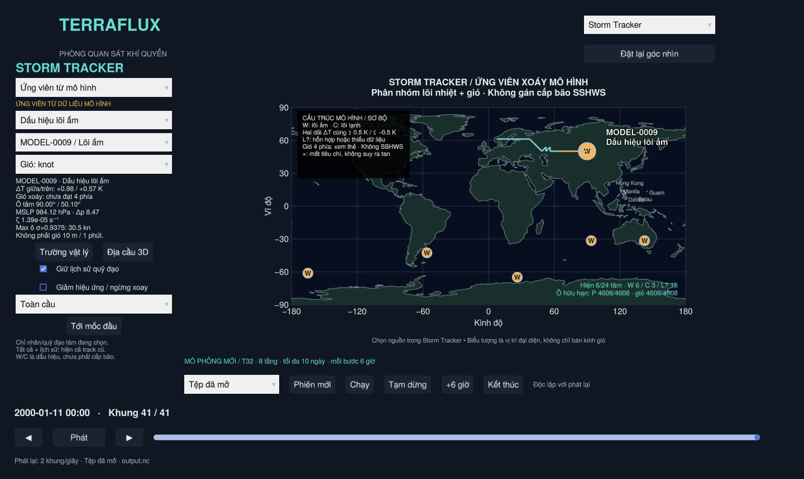

# Ứng viên xoáy từ dữ liệu mô hình

Trong **Storm Tracker**, chọn nguồn **Ứng viên từ mô hình**. Nguồn phân tích là
**tệp/phiên khí quyển đang được viewer chọn**, không phải kịch bản DEMO. Khi dùng
dữ liệu mẫu, bấm **Tới mốc đầu** để tới mốc có ứng viên đầu tiên; mốc khởi tạo
có thể chưa có đủ dữ liệu hoặc chưa có tâm đạt tiêu chí.


Đây là chẩn đoán sơ bộ các tâm áp thấp đi kèm xoáy thuận trên lưới mô hình,
**không phải bộ xác nhận bão nhiệt đới, không phải dự báo và không gán SSHWS**.
Các ký hiệu cấu trúc là `W` (dấu hiệu lõi ấm), `C` (dấu hiệu lõi lạnh), `L?`
(hỗn hợp/chưa đủ dữ liệu). Chúng khác các loại được khai báo trong kịch bản.
Định nghĩa Mỹ và điều kiện để xếp TD/TS/TY/SSHWS nằm trong
[`STORM_CLASSIFICATION_US.txt`](../STORM_CLASSIFICATION_US.txt). Nguồn mô hình hiện
chưa có xác nhận TC và gió 1 phút/10 m nên không đổi W/C/L? thành TD/TS/TY/EX
hay Category chỉ dựa vào một số đo.

## Đọc bản đồ và bộ lọc

- Mặc định **Đang hoạt động** chỉ liệt kê các tâm đạt tiêu chí ở mốc đang xem.
  Chọn một tâm bằng menu hoặc bấm chấm tròn để xem thẻ. Khi tâm đang chọn mất
  dấu, tự chuyển sang một tâm còn hoạt động; không giữ thẻ MODEL-0001 đã hết dấu.
- Chấm tròn nhỏ, màu theo nhóm cấu trúc; chỉ tâm đang chọn có nhãn và quỹ đạo.
  Chấm mô hình mặc định không xoay hoặc có cánh bão. Kích thước không chỉ bán kính.
- Bộ lọc **Dấu hiệu lõi ấm**, **Dấu hiệu lõi lạnh**, **Hỗn hợp / chưa rõ** dùng
  chẩn đoán tại đúng mốc hiện tại. Lõi ấm không đồng nghĩa TC; lõi lạnh không đủ
  để kết luận EX. Kiểm tra gió bốn phía được ghi riêng trên thẻ.
- **Tất cả + lịch sử** mở danh sách các ID đã sinh và quỹ đạo cũ nếu checkbox
  quỹ đạo bật. Tâm tương lai vẫn bị ẩn; dấu × là mất tiêu chí, không kết luận tan.
- **Tới mốc đầu** tuân theo bộ lọc. Nếu cả tệp/phiên không có nhóm đó thì báo
  không có, không thay ngưỡng hoặc dựng điểm cho đủ hình.
- Tổng trên bản đồ tách số đang hiện/số phát hiện và đếm W/C/L? ở mốc đó. Đổi
  bộ lọc chỉ đổi hiển thị, không sửa kết quả nhận diện, ID hay dữ liệu mô hình.



## Dữ liệu và công thức

- Dùng `mslp` (hPa), `u`, `v` (m/s), `temp` (°C) từ NetCDF/phiên live hiện có.
  Không có nhiệt độ vẫn tìm ứng viên áp suất/gió, nhưng nhóm nhiệt là chưa rõ.
- Dùng tầng sigma lớn nhất, tức tầng thấp nhất được ghi trong dữ liệu. Với mẫu
  T32/8 tầng là σ=0.9375. Gió này **không phải gió bề mặt 10 m duy trì 1 phút**.
- Độ xoáy tương đối thẳng đứng được tính bằng sai phân trung tâm trên mặt cầu:

  `ζ = [∂v/∂λ − ∂(u cosφ)/∂φ] / (a cosφ)`

  với `a=6,371,000 m`, kinh/vĩ độ tính bằng radian. Đạo hàm theo vĩ độ sử dụng
  công thức ba điểm cho khoảng cách vĩ độ không đều; kinh độ tuần hoàn toàn cầu.
- Hiện hỗ trợ lưới kinh độ toàn cầu đều, vĩ độ tăng, các tầng sigma trong (0,1],
  thời gian tăng nghiêm ngặt và bán kính Trái Đất mặc định. Tệp khu vực, tọa độ
  đứng khác sigma hoặc hành tinh bán kính khác chưa được hỗ trợ cho chẩn đoán này.

## Tiêu chí mặc định — thử nghiệm, chưa hiệu chỉnh bằng quan trắc

Một ô là ứng viên khi đồng thời đạt:

1. |Vĩ độ| từ **5° tới 70°**; bỏ biên vĩ độ và vùng sát xích đạo/cực.
2. MSLP dương, hữu hạn, là cực tiểu trong 8 ô lân cận. Ô bằng áp suất được chọn
   theo thứ tự chỉ số nhất quán; nền áp suất phẳng không được coi là cực tiểu.
3. Độ xoáy thuận `sgn(φ)·ζ ≥ 1×10⁻⁵ s⁻¹`.
4. Áp suất trung bình trên vành **750–1500 km** cao hơn ô tâm ít nhất **2 hPa**.
   Cần ít nhất 8 ô vành, ≥80% số ô vành có áp suất hữu hạn, có dữ liệu ở cả bốn
   góc phần tư. Đây là tiêu chí độ trũng, chưa phải kiểm tra đường đẳng áp đóng.
5. Các tâm cách nhau ít nhất **800 km**, ưu tiên tâm áp suất thấp hơn; tối đa
   **32 tâm/mốc**. Nếu giới hạn bị chạm, giao diện thông báo thay vì coi số tâm
   còn lại là toàn bộ số tâm có thể tìm được.

Gió hiển thị là cực đại các **ô lưới** hữu hạn trong vòng **750 km** quanh tâm,
trên tầng sigma nói trên. Thẻ còn có MSLP ô tâm, độ trũng Δp và ζ có dấu. Các giá
trị này là chẩn đoán từ mô hình, không suy ra cấp bão, ACE, tác động hay ENSO.

Thiếu áp suất/gió, xoáy nghịch hoặc áp suất phẳng có thể cho kết quả **0 ứng viên**.
Bản đồ hiện số ô áp suất/gió hữu hạn để phân biệt dữ liệu thiếu với trường hợp
không đạt tiêu chí. Không thay dữ liệu thiếu bằng giá trị giả.

## Dấu hiệu cấu trúc — thử nghiệm, không phải bộ phân loại nghiệp vụ NOAA

`src/structure.jl` đọc các trường gốc tại từng mốc, không dùng vị trí hay số
liệu tương lai để phân nhóm.

**Dị thường lõi nhiệt:**

1. Lấy lõi trong **500 km** và vành nền **750–1500 km** quanh tâm áp suất.
   Mỗi tầng cần ≥3 ô lõi, ≥8 ô vành, ≥80% số ô trong từng vùng hữu hạn và vành
   có dữ liệu ở cả bốn góc phần tư. Trọng số diện tích gần đúng là cos(vĩ độ).
2. Tại mỗi tầng, khớp mặt phẳng nhiệt độ `T=a+b*x+c*y` từ vành nền bằng bình
   phương tối thiểu có trọng số. `x,y` là khoảng cách địa phương đông/bắc tính
   trong đơn vị 1000 km, kinh độ được quấn qua đường đổi ngày. Dị thường là
   trung bình lõi của `T thực - T nền khớp tại chính ô đó`. Cách này loại một
   gradient nền tuyến tính, tránh coi chênh nhiệt bắc–nam đơn thuần là lõi.
3. Bình quân số học dị thường của các tầng trong dải giữa **0.4≤σ≤0.75** và
   dải trên **0.2≤σ<0.4**, riêng từng dải. Mỗi dải cần ít nhất một tầng và mọi
   tầng được chọn phải có đủ dữ liệu; không tự lấy một tầng xa thay thế dải thiếu.
4. Cả hai dải ≥**+0.5 K**: `:warm` / W. Cả hai ≤**−0.5 K**: `:cold` / C.
   Dữ liệu đủ nhưng không cùng vượt ngưỡng: `:mixed` / L?. Thiếu dải/ô hoặc nền
   không khớp được: `:unknown` / L?. Chênh lệch °C bằng chênh lệch K.

**Gió xoáy bốn phía:**

- Dùng gió tầng sigma thấp nhất trên vành **500–1000 km**, chia bốn góc phần tư.
  Mỗi phần cần ≥2 ô hợp lệ và ≥80% số ô của phần đó. Không đủ thì trạng thái
  **thiếu dữ liệu**, khác trạng thái dữ liệu đủ nhưng không đạt.
- Thành phần tiếp tuyến hướng xoáy thuận dùng góc phương vị cầu tại ô đo và
  đổi dấu theo bán cầu. Nếu β là phương vị từ ô gió hướng tới tâm (đo từ bắc),
  `Vt=sgn(vĩ độ tâm)*(u*cosβ-v*sinβ)`.
- Từng phần bình quân cos(vĩ độ); cả bốn trung bình ≥**2 m/s** mới ghi
  **đạt 4/4 phía**. Gió nền thổi thẳng mạnh có thể không đạt dù cực đại gió lớn.

Ngưỡng 0.5 K, bán kính/dải sigma và 2 m/s là lựa chọn thử nghiệm công khai của
project, **không phải ngưỡng phân loại TC chính thức của Mỹ**. Đây không phải
Cyclone Phase Space của Hart: chưa tính độ dày trên mặt đẳng áp, cấu trúc front,
đối xứng đối lưu hoặc nguồn năng lượng. Kiểm tra bốn phía không chứng minh đường
dòng bề mặt kín. Sigma phụ thuộc áp suất mặt đất, nên địa hình và quy giảm MSLP
vẫn có thể tạo tín hiệu giả. Chưa có kiểm định bằng quan trắc/gán nhãn.

`metrics` lưu hai dị thường, các sigma đã dùng, lý do nhóm nhiệt, trạng thái
gió và bốn trung bình tiếp tuyến. Nhóm có thể đổi theo thời gian mà ID tiếp tục
nếu vẫn được liên kết theo vị trí. Quỹ đạo tô theo nhóm ở đầu đoạn, không tô lại
toàn bộ quá khứ bằng nhóm hiện tại.

## ID và đường theo dõi

- `MODEL-0001`, `MODEL-0002`, … cấp theo thứ tự sinh, dựa chỉ vào các mốc đã đi qua.
  Phân tích thêm các mốc sau không thay ID/quan trắc của tiền tố trước đó.
- Nối các tâm ở hai mốc liên tiếp, cùng bán cầu, theo cặp khoảng cách gần nhất;
  mỗi tâm/ID chỉ được ghép một lần. Khoảng ghép tối đa là **35 m/s × Δt + 400 km**
  dung sai lưới. Không nối khi Δt > **12 giờ**.
- Một mốc không có tâm đạt tiêu chí sẽ ngắt track. Tâm tái xuất hiện nhận ID mới;
  không bù khoảng trống và không nội suy trạng thái mô hình ở giữa các mốc.
- Dấu × nghĩa là mất tiêu chí/ngắt đoạn, **không chứng minh một cơn bão đã tan**.
  Track còn có tâm tại mốc cuối tệp không bị đánh dấu tan chỉ vì tệp hết dữ liệu.
- Chỉ hiện ID sau khi đã xuất hiện ở mốc đang xem; quỹ đạo không vẽ phần tương lai.
  Đoạn qua đường đổi ngày được ngắt để không nối một dây dài ngang bản đồ.
- ID ổn định trong một tập dữ liệu/phiên. ID không định danh cùng cơn bão giữa
  các thí nghiệm khác nhau; `source_path`, cấu hình, tầng, số liệu từng mốc và các
  báo cáo dữ liệu được giữ trong kết quả `ModelStormSet`.

Ghép gần nhất là một heuristic, có thể đổi nhầm ID khi các hệ thống đến gần,
tách/hợp nhất hoặc di chuyển nhanh. Chưa có bộ xử lý các trường hợp này đầy đủ.

## Tách biệt với kịch bản và mô phỏng

- Kịch bản vẫn dùng thang gió được khai báo; nguồn mô hình dùng `MODEL_LOW`,
  `MODEL_WARM`, `MODEL_COLD`, không tự gán loại nghiệp vụ hay SSHWS.
  Menu, chú giải, thẻ và các lớp hình đều đổi theo nguồn; không trộn track DEMO
  vào kết quả từ mô hình.
- Phân tích chạy nền và đọc dữ liệu. Không sửa trạng thái khí quyển, không chạy
  thêm mô hình khi đổi chế độ, không thay các mảng NetCDF đã nạp.
- Cache bị làm mới khi đổi tệp/nguồn live hoặc có mốc mới. Trong lúc chờ dữ liệu
  mới được phân tích, giao diện ghi đang phân tích thay vì dùng kết quả cũ như
  thể nó thuộc mốc mới.
- Có thể chọn ứng viên rồi mở cùng ô/thời gian trong trường vật lý hoặc địa cầu.
- Ảnh icon tùy biến dùng `[sprites.MODEL_LOW]`, `[sprites.MODEL_WARM]`,
  `[sprites.MODEL_COLD]`. Không tự mượn ảnh
  `[sprites.default]` của bão nhiệt đới; không có ảnh riêng thì dùng hình dự phòng.

## Giới hạn vật lý và kiểm chứng

Lưới T32 thô khoảng vài trăm km. Các cực tiểu/xoáy có thể là hệ ngoại nhiệt đới,
rãnh áp, nhiễu số hay ảnh hưởng địa hình (nhất là MSLP quy giảm qua địa hình cao).
Bộ tiêu chí có dấu hiệu nhiệt thẳng đứng và gió bốn phía sơ bộ, nhưng chưa xác
nhận lõi ấm theo một phương pháp được kiểm định, gió duy trì chuẩn, đóng kín
hoàn lưu hay độ bền đủ để kết luận là xoáy thuận nhiệt đới. Các ngưỡng trên là
lựa chọn thử nghiệm công khai, không phải chuẩn phân loại khí tượng đã kiểm định.

`test/detection.jl` kiểm tra xoáy giả lập biết trước, xoáy nghịch/nền phẳng, hai
bán cầu, đạo hàm với nghiệm quay khối rắn, ngắt mốc, đường đổi ngày, giới hạn tốc
độ/số tâm và ID tiền tố. `test/detection_viewer.jl` đối chiếu NetCDF thật và kiểm tra
nguồn, dữ liệu không đổi, không lộ ID tương lai, đổi 2D/3D, cache và kết quả rỗng.
Những kiểm tra này xác nhận hành vi thuật toán/UI, **chưa đo độ chính xác nhận diện
bão bằng quan trắc hoặc dữ liệu gán nhãn**.
`test/structure.jl` dùng trường xoáy/nhiệt biết trước: lõi ấm/lạnh, gradient nền,
hai bán cầu, đường đổi ngày, gió thẳng mạnh, thiếu dữ liệu/tầng và tiền tố ID.
Kiểm tra GUI tái hiện khung cuối NetCDF: chọn tự động, lọc nhóm, chỉ một nhãn/
quỹ đạo mặc định, click chấm nhỏ và cô lập đầu vào menu bộ lọc.

API phân tích:

```julia
include("src/data.jl")
include("src/storms.jl")
include("src/detection.jl")
using .TerraFluxData, .TerraFluxDetection
weather = load_weather("run_0001/output.nc")
result = detect_tracks(weather; config=DetectionConfig())
```

Các giá trị mặc định được định nghĩa tập trung ở `DetectionConfig` trong
`src/detection.jl`; thay đổi tiêu chí hiện cần sửa mã/API rồi mở lại app.
