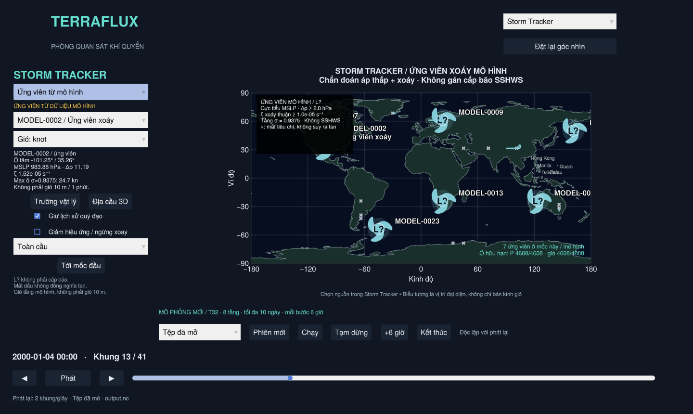

# Ứng viên xoáy từ dữ liệu mô hình

Trong **Storm Tracker**, chọn nguồn **Ứng viên từ mô hình**. Nguồn phân tích là
**tệp/phiên khí quyển đang được viewer chọn**, không phải kịch bản DEMO. Khi dùng
dữ liệu mẫu, bấm **Tới mốc đầu** để tới mốc có ứng viên đầu tiên; mốc khởi tạo
có thể chưa có đủ dữ liệu hoặc chưa có tâm đạt tiêu chí.



Đây là chẩn đoán sơ bộ các tâm áp thấp đi kèm xoáy thuận trên lưới mô hình,
**không phải bộ xác nhận bão nhiệt đới, không phải dự báo và không gán SSHWS**.
`L?` là ký hiệu ứng viên, khác `L` nhiễu động được khai báo trong kịch bản.

## Dữ liệu và công thức

- Dùng `mslp` (hPa) và gió `u`, `v` (m/s) từ NetCDF/phiên live hiện có.
- Dùng tầng sigma lớn nhất, tức tầng thấp nhất được ghi trong dữ liệu. Với mẫu
  T32/8 tầng là σ=0.9375. Gió này **không phải gió bề mặt 10 m duy trì 1 phút**.
- Độ xoáy tương đối thẳng đứng được tính bằng sai phân trung tâm trên mặt cầu:

  `ζ = [∂v/∂λ − ∂(u cosφ)/∂φ] / (a cosφ)`

  với `a=6,371,000 m`, kinh/vĩ độ tính bằng radian. Đạo hàm theo vĩ độ sử dụng
  công thức ba điểm cho khoảng cách vĩ độ không đều; kinh độ tuần hoàn toàn cầu.
- Hiện hỗ trợ lưới kinh độ toàn cầu đều, vĩ độ tăng, các tầng sigma trong (0,1],
  thời gian tăng nghiêm ngặt và bán kính Trái Đất mặc định. Tệp khu vực, tọa độ
  đứng khác sigma hoặc hành tinh bán kính khác chưa được hỗ trợ cho chẩn đoán này.

## Tiêu chí mặc định — thử nghiệm, chưa hiệu chỉnh bằng quan trắc

Một ô là ứng viên khi đồng thời đạt:

1. |Vĩ độ| từ **5° tới 70°**; bỏ biên vĩ độ và vùng sát xích đạo/cực.
2. MSLP dương, hữu hạn, là cực tiểu trong 8 ô lân cận. Ô bằng áp suất được chọn
   theo thứ tự chỉ số nhất quán; nền áp suất phẳng không được coi là cực tiểu.
3. Độ xoáy thuận `sgn(φ)·ζ ≥ 1×10⁻⁵ s⁻¹`.
4. Áp suất trung bình trên vành **750–1500 km** cao hơn ô tâm ít nhất **2 hPa**.
   Cần ít nhất 8 ô vành, ≥80% số ô vành có áp suất hữu hạn, có dữ liệu ở cả bốn
   góc phần tư. Đây là tiêu chí độ trũng, chưa phải kiểm tra đường đẳng áp đóng.
5. Các tâm cách nhau ít nhất **800 km**, ưu tiên tâm áp suất thấp hơn; tối đa
   **32 tâm/mốc**. Nếu giới hạn bị chạm, giao diện thông báo thay vì coi số tâm
   còn lại là toàn bộ số tâm có thể tìm được.

Gió hiển thị là cực đại các **ô lưới** hữu hạn trong vòng **750 km** quanh tâm,
trên tầng sigma nói trên. Thẻ còn có MSLP ô tâm, độ trũng Δp và ζ có dấu. Các giá
trị này là chẩn đoán từ mô hình, không suy ra cấp bão, ACE, tác động hay ENSO.

Thiếu áp suất/gió, xoáy nghịch hoặc áp suất phẳng có thể cho kết quả **0 ứng viên**.
Bản đồ hiện số ô áp suất/gió hữu hạn để phân biệt dữ liệu thiếu với trường hợp
không đạt tiêu chí. Không thay dữ liệu thiếu bằng giá trị giả.

## ID và đường theo dõi

- `MODEL-0001`, `MODEL-0002`, … cấp theo thứ tự sinh, dựa chỉ vào các mốc đã đi qua.
  Phân tích thêm các mốc sau không thay ID/quan trắc của tiền tố trước đó.
- Nối các tâm ở hai mốc liên tiếp, cùng bán cầu, theo cặp khoảng cách gần nhất;
  mỗi tâm/ID chỉ được ghép một lần. Khoảng ghép tối đa là **35 m/s × Δt + 400 km**
  dung sai lưới. Không nối khi Δt > **12 giờ**.
- Một mốc không có tâm đạt tiêu chí sẽ ngắt track. Tâm tái xuất hiện nhận ID mới;
  không bù khoảng trống và không nội suy trạng thái mô hình ở giữa các mốc.
- Dấu × nghĩa là mất tiêu chí/ngắt đoạn, **không chứng minh một cơn bão đã tan**.
  Track còn có tâm tại mốc cuối tệp không bị đánh dấu tan chỉ vì tệp hết dữ liệu.
- Chỉ hiện ID sau khi đã xuất hiện ở mốc đang xem; quỹ đạo không vẽ phần tương lai.
  Đoạn qua đường đổi ngày được ngắt để không nối một dây dài ngang bản đồ.
- ID ổn định trong một tập dữ liệu/phiên. ID không định danh cùng cơn bão giữa
  các thí nghiệm khác nhau; `source_path`, cấu hình, tầng, số liệu từng mốc và các
  báo cáo dữ liệu được giữ trong kết quả `ModelStormSet`.

Ghép gần nhất là một heuristic, có thể đổi nhầm ID khi các hệ thống đến gần,
tách/hợp nhất hoặc di chuyển nhanh. Chưa có bộ xử lý các trường hợp này đầy đủ.

## Tách biệt với kịch bản và mô phỏng

- Kịch bản vẫn dùng thang gió được khai báo, còn nguồn mô hình chỉ dùng `MODEL_LOW`.
  Menu, chú giải, thẻ và các lớp hình đều đổi theo nguồn; không trộn track DEMO
  vào kết quả từ mô hình.
- Phân tích chạy nền và đọc dữ liệu. Không sửa trạng thái khí quyển, không chạy
  thêm mô hình khi đổi chế độ, không thay các mảng NetCDF đã nạp.
- Cache bị làm mới khi đổi tệp/nguồn live hoặc có mốc mới. Trong lúc chờ dữ liệu
  mới được phân tích, giao diện ghi đang phân tích thay vì dùng kết quả cũ như
  thể nó thuộc mốc mới.
- Có thể chọn ứng viên rồi mở cùng ô/thời gian trong trường vật lý hoặc địa cầu.
- Ảnh icon tùy biến cho ứng viên dùng `[sprites.MODEL_LOW]`. Không tự mượn ảnh
  `[sprites.default]` của bão nhiệt đới; không có ảnh riêng thì dùng hình dự phòng.

## Giới hạn vật lý và kiểm chứng

Lưới T32 thô khoảng vài trăm km. Các cực tiểu/xoáy có thể là hệ ngoại nhiệt đới,
rãnh áp, nhiễu số hay ảnh hưởng địa hình (nhất là MSLP quy giảm qua địa hình cao).
Bộ tiêu chí chưa kiểm tra lõi ấm, cấu trúc thẳng đứng, gió duy trì chuẩn, đóng kín
hoàn lưu hay độ bền đủ để kết luận là xoáy thuận nhiệt đới. Các ngưỡng trên là
lựa chọn thử nghiệm công khai, không phải chuẩn phân loại khí tượng đã kiểm định.

`test/detection.jl` kiểm tra xoáy giả lập biết trước, xoáy nghịch/nền phẳng, hai
bán cầu, đạo hàm với nghiệm quay khối rắn, ngắt mốc, đường đổi ngày, giới hạn tốc
độ/số tâm và ID tiền tố. `test/detection_viewer.jl` đối chiếu NetCDF thật và kiểm tra
nguồn, dữ liệu không đổi, không lộ ID tương lai, đổi 2D/3D, cache và kết quả rỗng.
Những kiểm tra này xác nhận hành vi thuật toán/UI, **chưa đo độ chính xác nhận diện
bão bằng quan trắc hoặc dữ liệu gán nhãn**.

API phân tích:

```julia
include("src/data.jl")
include("src/storms.jl")
include("src/detection.jl")
using .TerraFluxData, .TerraFluxDetection
weather = load_weather("run_0001/output.nc")
result = detect_tracks(weather; config=DetectionConfig())
```

Các giá trị mặc định được định nghĩa tập trung ở `DetectionConfig` trong
`src/detection.jl`; thay đổi tiêu chí hiện cần sửa mã/API rồi mở lại app.
