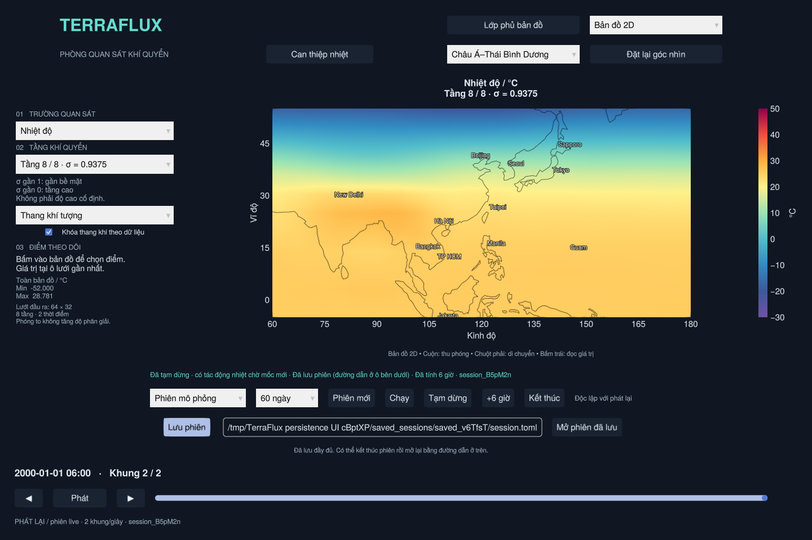

# Lưu và mở lại phiên mô phỏng live

**Lưu phiên** giữ trạng thái vật lý để đóng ứng dụng rồi tính tiếp vào lần sau.
Nó dùng cho phiên live trong viewer, bao gồm phiên có can thiệp nhiệt.



1. Tạo **Phiên mới**, tính ít nhất **+6 giờ**, rồi **Tạm dừng** và chờ xử lý
   hết lệnh. Bấm **Lưu phiên** dưới dải điều khiển mô phỏng.
2. Chờ thông báo **Đã lưu đầy đủ**. Ô bên cạnh hiện đường dẫn `session.toml`.
   Mỗi lần lưu tạo một thư mục mới ở `sessions/saved_sessions/saved_…/`.
3. Có thể **Kết thúc** phiên hoặc đóng ứng dụng. Để chuyển sang máy/thư mục
   khác, sao chép **cả thư mục `saved_…`**, không chỉ riêng `session.toml`.
4. Mở viewer, dán đường dẫn `session.toml` hoặc thư mục bản lưu vào ô, rồi
   bấm **Mở phiên đã lưu**. Đường dẫn có dấu cách/dấu ngoặc kép được hỗ trợ;
   không cần bấm Enter trước. Kết thúc phiên đang chạy trước khi mở phiên khác.
5. Chờ **Đã khôi phục**, rồi bấm **+6 giờ** hoặc **Chạy** để tính tiếp.
   Thanh **Phát** chỉ xem lại dữ liệu và không tính thêm thời gian vật lý.

Trong một cửa sổ, bản lưu phải có cùng T/số tầng với dữ liệu đang mở. Để mở
bản lưu khác lưới/tầng, kéo `session.toml` lên **Open_TerraFlux.bat** để tạo
cửa sổ đúng cấu hình. Linux/macOS:

```sh
./open_terraflux.sh '/path/to/saved_abc/session.toml'
# Hoặc:
julia --threads=2 --project=. viewer.jl '/path/to/saved_abc'
```

Việc mở luôn tạo workspace `sessions/session_…/` mới, sao chép lịch sử đã đóng
và khôi phục ở trạng thái tạm dừng. Bản lưu gốc không bị ghi đè. Nút Lưu giữ mốc mới nhất
của worker; kéo thanh thời gian về quá khứ không quay lại trạng thái vật lý.
Giới hạn ngày của phiên được giữ từ cấu hình gốc; đổi menu thời lượng không gia hạn bản lưu.
Lưu trước khi **Kết thúc** hoặc đạt giới hạn ngày: worker đã thoát không thể
tạo checkpoint mới. Bản lưu chỉ có hiệu lực sau thông báo hoàn tất; đóng app
giữa lúc lưu có thể để lại thư mục `.saving_…` chưa hoàn chỉnh.

## Trạng thái được giữ

- Biến trạng thái, hai bộ đệm leapfrog, đồng hồ và RNG của task worker;
  mô hình mặc định `PrimitiveWetModel` trên CPU được dựng lại cùng T/số tầng.
- Toàn bộ các đoạn NetCDF 6 giờ đã hoàn tất, theo đúng thứ tự. Lịch sử chỉ
  nạp một lần vào RAM khi mở, không nối lại toàn bộ chuỗi ở mỗi đoạn nhập.
- Tác động nhiệt đang chờ mốc mới và checkpoint hoàn tác gần nhất nếu còn
  hiệu lực. Các khung đã ghi vẫn là trước tác động; cần tính tiếp để xem phản ứng.
- Nhật ký lệnh và sự kiện nhiệt tới thời điểm lưu, kể cả nhật ký kế thừa từ
  những lần mở trước. Nhật ký được giữ làm hồ sơ, **không chạy lại lệnh cũ**.

Đây là lưu trạng thái vật lý; camera, điểm ghim, lớp phủ và lựa chọn trường
quan sát chưa được lưu. Dùng **Thí nghiệm A/B** để tạo nhánh đối chứng/can
thiệp từ bản lưu: [AB_EXPERIMENTS.md](AB_EXPERIMENTS.md).

## Tệp và kiểm tra khi mở

| Tệp/thư mục | Nội dung |
| --- | --- |
| `session.toml` | Định dạng, phiên bản, cấu hình, mốc thời gian, trạng thái tác động và SHA-256/kích thước từng tệp |
| `state.jld2` | Checkpoint tại thời điểm lưu |
| `undo.jld2` | Checkpoint hoàn tác một cấp, chỉ có khi còn hiệu lực |
| `history/` | NetCDF của tất cả đoạn 6 giờ đã hoàn tất |
| `journal/session_…/commands/`, `events/` | Lệnh và sự kiện, phân theo ID workspace nguồn |

Các đường dẫn phụ thuộc để khôi phục là tương đối trong bản lưu. Đường dẫn
checkpoint cũ bên trong sự kiện là hồ sơ lịch sử; các checkpoint trước/sau
của mọi tác động cũ không được sao chép hết. Chỉ trạng thái hiện tại và một
checkpoint hoàn tác còn hiệu lực được đóng gói. Giữ workspace cũ nếu cần
đối chiếu toàn bộ checkpoint của thí nghiệm.

Worker kiểm tra checksum trước khi đọc trạng thái, rồi kiểm tra lưới, tầng,
đồng hồ, lịch sử liên tục và trường trạng thái hữu hạn. Bản thiếu/hỏng/khác
phiên bản sẽ báo lỗi. Hiện yêu cầu **cùng phiên bản Julia và SpeedyWeather**
(repo hiện khóa Julia 1.13.3 / SpeedyWeather 0.23.0); chưa có chuyển đổi định dạng.
Không nhận NetCDF bất kỳ hoặc restart của batch làm phiên live.

Bản lưu sao chép đầy đủ lịch sử mỗi lần, nên cần thêm dung lượng đĩa tương
ứng. Viewer vẫn nạp chuỗi vào RAM; đây chưa phải trình đọc dữ liệu theo trang.
Physics vẫn dùng CPU; không có backend GPU mới trong chức năng này.

## Kiểm chứng

```sh
julia --project=. test/saved_manifest.jl
julia --project=. test/live_history.jl
julia --threads=2 --project=. test/session_resume.jl /path/to/new-test-directory
# Cần màn hình/OpenGL; dùng archive thực được tạo bởi bài kiểm tra phía trên:
julia --threads=2 --project=. test/session_viewer.jl '/path/to/new-test-directory/relocated archive/session.toml'
# Mở trực tiếp một bản lưu nhiều đoạn và kiểm tra lưu rồi kết thúc:
julia --threads=2 --project=. test/session_launch.jl '/path/to/session.toml'
```

Kiểm tra mô hình thật ở T21/8 tầng: lưu sau tác động nhiệt tại giờ 6, chuyển
bản lưu, xóa phiên/thư mục gốc, mở trong tiến trình mới, hoàn tác và áp dụng
lại cùng tác động, rồi tính tới giờ 12. So sánh tất cả trường đầu ra ở mốc cuối
với phiên không đóng, sai số tuyệt đối 2e-4/tương đối 2e-5. Đây là kiểm chứng
luồng `run!` từng đoạn 6 giờ của TerraFlux, không khẳng định trùng bit với một
lời gọi tích phân dài hoặc mọi cấu hình vật lý/backend của thư viện.

Kiểm tra GUI dùng thao tác chuột thật vào nút Lưu/Mở, đường dẫn có dấu cách/
ngoặc kép, dữ liệu trước tác động, tính tiếp, chuyển chế độ và báo lỗi đường
dẫn. Các kiểm tra chạy trên Linux/OpenGL phần mềm; launcher Windows chưa được
chạy trực tiếp trong cloud này.
