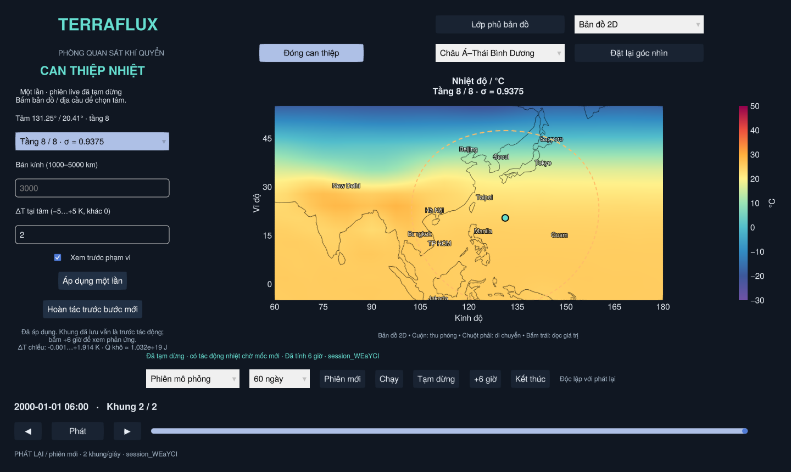

# V2 đầu tiên: làm nóng/lạnh một vùng khí quyển

Mở `Open_TerraFlux.bat` như trước. Công cụ **Can thiệp nhiệt** nằm ở đầu cửa sổ
trong Bản đồ 2D/Địa cầu 3D và dùng cùng tầng, điểm ghim và phiên live.

1. Bấm **Phiên mới**, chờ khởi tạo rồi bấm **+6 giờ**. Chờ **Đã tạm dừng**.
2. Chọn nguồn **Phiên mô phỏng** và mốc cuối đã lưu. Bấm bản đồ hoặc địa cầu
   để chọn tâm vùng. Tệp đã mở chỉ dùng xem, không bị sửa.
3. Bấm **Can thiệp nhiệt**. Chọn tầng sigma, bán kính 1000–5000 km và
   ΔT tại tâm từ −5 đến +5 K, khác 0. Chênh lệch 1 K bằng chênh lệch 1 °C.
4. Bật **Xem trước phạm vi** để kiểm tra vòng trên bản đồ/địa cầu, rồi bấm
   **Áp dụng một lần**. Worker lưu checkpoint trước/sau và ghi nhật ký.
5. Bấm **Hoàn tác trước bước mới** để trở lại trạng thái trước tác động gần
   nhất, hoặc **+6 giờ/Chạy** để cho mô hình tính phản ứng vật lý tiếp theo.



Đây là tác động **một lần lên một tầng khí quyển**. Nó không giữ nhiệt độ vùng
cố định trong các bước sau, không làm nóng SST hay toàn cột khí quyển. Gió/ẩm/
áp suất không bị gán số mới bằng công cụ này; mô hình sẽ tính phản ứng của chúng.

## Thời gian, dữ liệu đã lưu và hoàn tác

Áp dụng/hoàn tác không tính thêm thời gian mô hình. Các khung NetCDF đã ghi
giữ nguyên làm hồ sơ **trước tác động**. Vì vậy bấm Áp dụng không tự tô lại số
của khung cũ: trạng thái vật lý nội bộ đã đổi, còn bản đồ đang đọc khung đã lưu.
Giao diện ghi rõ tác động đang chờ mốc mới. Khung sau **+6 giờ** cho thấy trạng
thái đã tiến triển từ tác động đó. Nhật ký ghi thời điểm chèn chính xác, không
coi tác động là thay đổi dần trong khoảng giữa hai khung.

Chỉ cho thao tác khi worker đã tạm dừng, xử lý hết lệnh và bản đồ đang ở mốc
cuối của nguồn live. Chọn một khung quá khứ không tua ngược trạng thái vật lý.
Thao tác ở tệp mẫu/khung cũ bị từ chối. Đổi camera/chế độ không tác động mô hình.

Hoàn tác một cấp chỉ dùng trước bước tính tiếp theo. Khi đã tính tiếp, checkpoint
vẫn nằm trên đĩa để đối chiếu nhưng nút không quay ngược một nhánh đã tiến triển.
Dùng **Lưu phiên / Mở phiên đã lưu** để giữ trạng thái này qua lần đóng ứng
dụng, kể cả quyền hoàn tác còn hiệu lực: [SAVED_SESSIONS.md](SAVED_SESSIONS.md).
Dùng **Thí nghiệm A/B** để so sánh nhánh không nhận tác động mới với nhánh
được làm nóng/lạnh từ cùng checkpoint: [AB_EXPERIMENTS.md](AB_EXPERIMENTS.md).

## Hình dạng và phép tính

Tại khoảng cách cung cầu `d` tới tâm, đặt `r=d/R` và:

```
w(r) = (1-r)^4 (1+4r),  0 ≤ r < 1
w(r) = 0,              r ≥ 1
ΔT(lon, lat, sigma) = ΔT_tâm × w(r)  trên tầng được chọn
```

Dùng tọa độ native của SpeedyWeather, không sửa các pixel của bản đồ đầu ra.
Nhiễu nhiệt được chiếu sang phổ bằng API `set!` của thư viện và cộng cùng nhiễu
vào hai bộ đệm leapfrog. Các trường khác giữ nguyên tại thời điểm chèn; bước
`run!` kế tiếp khởi tạo/tính lại các chẩn đoán theo luồng live đang có.

Chiếu phổ toàn cầu có thể tạo đuôi/dao động nhỏ ngoài vòng danh nghĩa. Vòng xem
trước chỉ là vùng nhập, không bảo đảm phạm vi tác động sau chiếu hoặc sau diễn
biến khí quyển. Nhật ký lưu min/max ΔT thực sau chiếu, số ô native và trung bình
diện tích trên tầng; không mặc định max thực đúng bằng giá trị tại tâm lý tưởng.

Ước lượng nhiệt lượng khô được ghi bằng:

```
Q_khô ≈ (cp/g) × Δsigma × sum_i(area_i × ps_i × ΔT_i)
```

Diện tích lấy từ trọng số tích phân native trên mặt cầu, `ps` từ áp suất bề mặt
prognostic thật; `cp`, `g`, bán kính hành tinh và độ dày sigma lấy từ mô hình.
ΔT là trường đã chiếu phổ. Đây là ước lượng enthalpy khô, không phải ngân sách
năng lượng ẩm đầy đủ hay bằng chứng cân bằng tổng năng lượng.

## Kiểm tra và hồ sơ

Giới hạn ban đầu: R 1000–5000 km, |ΔT| ≤5 K, ít nhất bốn ô native có trọng số
>0.001, nhiệt độ tái dựng hai bộ đệm hữu hạn trong 100–400 K. Không âm thầm
cắt/clamp một đầu vào sai thành hợp lệ. Các giới hạn này là phạm vi thử nghiệm,
không bảo đảm mọi trạng thái/độ phân giải đều ổn định hoặc mô tả chính xác bão.

Mỗi thao tác có thư mục `sessions/session_…/edits/00000N/`:

- `before.jld2`, `after.jld2`: các biến trạng thái, đồng hồ, RNG của task worker,
  phiên bản Julia/SpeedyWeather. Dùng cùng mô hình/cấu hình của phiên hiện tại.
- `event.toml`: thời điểm vật lý, tọa độ, tầng, R, ΔT, số liệu sau chiếu và
  trạng thái applied/undone/rejected. Hoàn tác ghi sự kiện mới, không xóa lịch sử.
- Lệnh đầu vào vẫn có trong `commands/`; không ghi đè NetCDF đã hoàn tất.

Checkpoint được tạo trước khi sửa. Nếu lỗi trong quá trình áp dụng/lưu hậu trạng
thái, worker khôi phục checkpoint rồi báo từ chối; nếu không khôi phục được thì
dừng với lỗi. Sau khi tính tiếp, kiểm tra hữu hạn và phát hiện mất ổn định vẫn
áp dụng như live trước đây. Checkpoint chỉ dành cho cùng phiên bản/config; đây
chưa phải định dạng nhập tùy ý hay cam kết khôi phục mọi backend/stochastic model.

Kiểm thử:

```sh
julia --project=. test/thermal_patch.jl
julia --project=. test/live_queue.jl
julia --threads=2 --project=. test/thermal_model.jl
# Cần màn hình/OpenGL; chạy hai đoạn khí quyển thật cùng thao tác qua GUI:
julia --threads=2 --project=. test/intervention_viewer.jl
```

Mẫu xoáy áp thấp/gió/lõi ấm đã được bổ sung riêng trong
[IDEALIZED_VORTEX.md](IDEALIZED_VORTEX.md). Can thiệp hơi nước/gió tự do, áp
dụng tăng dần/duy trì và biểu đồ vùng A/B vẫn còn chờ.
