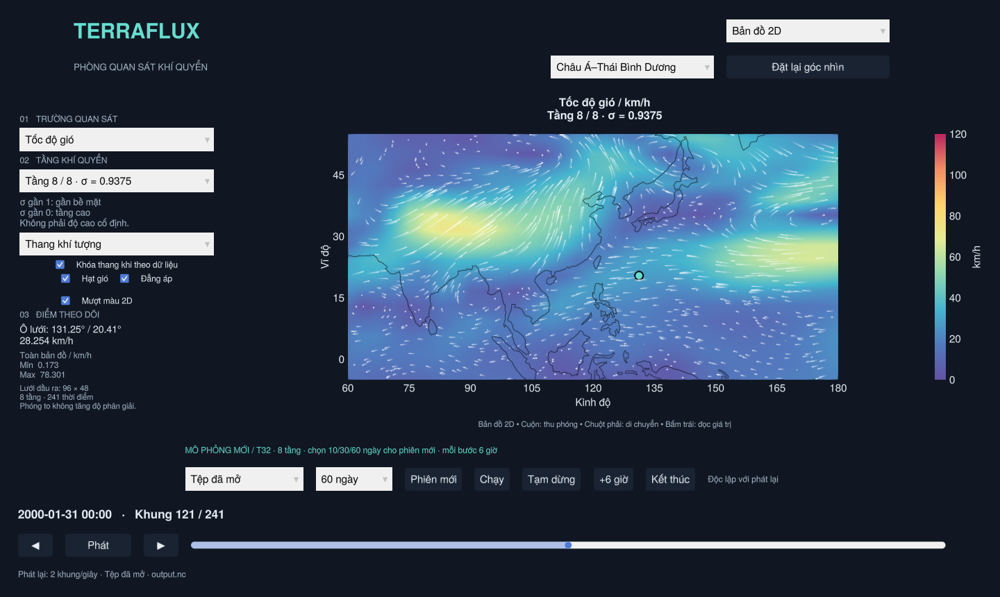
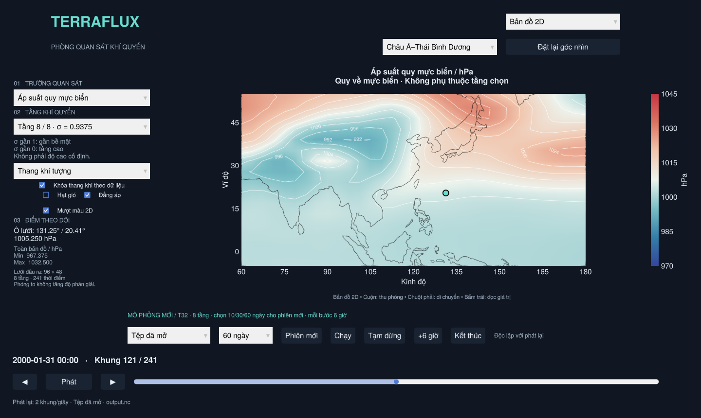
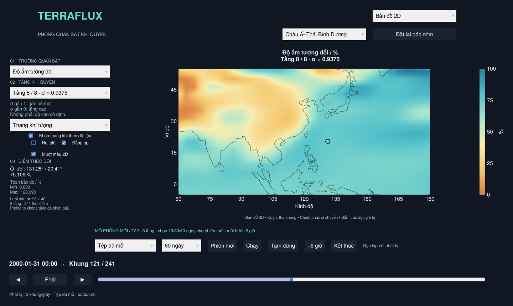

# Bản đồ màu khí tượng, hạt gió và bộ dữ liệu 60 ngày

Mở `Open_TerraFlux.bat` hoặc `open_terraflux.sh`. Mặc định app đọc bộ đã tạo sẵn
`datasets/earth_60d/run_0001/output.nc`: **60 ngày, 241 khung cách nhau 6 giờ**,
từ 2000-01-01 tới 2000-03-01. Bạn không cần tính lại trên máy để xem bộ này.
`run_0001/output.nc` cũ (10 ngày) vẫn có thể mở bằng kéo thả hoặc đối số đường dẫn.

## Bảng màu và lớp hiển thị

Ảnh Zoom Earth người dùng gửi là tham chiếu cách trình bày. Màu được xây lại
trong project; số liệu luôn từ thí nghiệm SpeedyWeather, không lấy số trên ảnh
làm dữ liệu. Lưới vẫn là T32 / 8 tầng, không phải ICON/GFS 13–22 km.

| Trường | Thang khí tượng mặc định | Màu |
| --- | --- | --- |
| Nhiệt độ | −30…50 °C | Tím/xanh → cyan → vàng/cam → đỏ/magenta |
| Tốc độ gió | 0…120 km/h | Tím/xanh → xanh ngọc → vàng → hồng |
| Độ ẩm tương đối | 0…100 % | Nâu/cam khô → vàng → xanh ngọc/xanh ẩm |
| Áp suất quy mực biển | 970…1045 hPa | Xanh áp thấp → trắng → đỏ áp cao |



- Menu **Thang khí tượng** dùng các khoảng cố định trên. **Theo dữ liệu** dùng
  min/max trường đang xem; checkbox khóa thang giữ cùng thang giữa các mốc.
  `u`, `v` và độ ẩm riêng vẫn dùng thang dữ liệu phù hợp đơn vị của chúng.
- Điểm theo dõi và min/max báo số chưa cắt theo thang màu. Giá trị vượt thang
  nhận màu đầu/cuối; không sửa số liệu để giữ trong khoảng màu.
- **Mượt bản đồ 2D / 3D** nội suy hình vẽ giữa các ô. Bấm/rê bản đồ vẫn đọc ô
  gần nhất; mượt hình không tăng độ phân giải mô hình. Chi tiết địa cầu và
  menu bật/tắt lớp phủ ở [MAP_OVERLAYS.md](MAP_OVERLAYS.md).
- **Đẳng áp** hiện khi xem áp suất trên 2D: đường trắng có nhãn, mặc định mỗi
  **4 hPa**, trong khoảng 880–1080 hPa. Có thể tắt bằng checkbox.
- Menu vùng ở đầu cửa sổ có **Châu Á–Thái Bình Dương** và **Toàn cầu**. Bản đồ
  khu vực mở ở 60–180°E, 5°S–55°N; kéo/phóng để xem vùng khác. Nút đặt lại góc
  nhìn dùng vùng đã chọn. Menu này chỉ nhận đầu vào ở chế độ 2D.



Các giá trị là của **tầng sigma đang chọn**, không phải nhiệt độ 2 m hoặc gió
10 m mặc định. Áp suất MSLP độc lập tầng chọn. Lớp gió đổi km/h để hiển thị;
mảng `u/v` vẫn là m/s và bộ phân loại bão vẫn dùng nguồn/chuẩn gió riêng.

## Độ ẩm tương đối và áp suất bề mặt

Độ ẩm riêng `q` (g/kg) và độ ẩm tương đối `%` là hai mục riêng. RH được tính từ
nhiệt độ, q và **áp suất bề mặt thực `pres`**, với áp suất tầng `p=σ*pres`.
Không dùng MSLP thay áp suất bề mặt ở địa hình cao.

- Đổi `q` sang kg/kg; áp suất dùng hPa.
- `e = q*p / (0.622 + 0.378*q)`.
- Áp suất hơi bão hòa theo công thức Bolton (1980), quy ước **trên nước lỏng**:
  `es = 6.112*exp(17.67*T/(T+243.5))`, với T bằng °C.
- `RH = 100*e/es`. Đây là chẩn đoán theo quy ước nước lỏng; không phải RH theo
  băng và không thêm chuyển pha nước/băng. Mã chỉ tính khi −100<T<100 °C,
  0≤q<1 kg/kg và áp suất dương/hữu hạn, tầng sigma trong (0,1].
- Không chặn số RH ở 100%; trường hợp >100% vẫn đọc đúng số và nhận màu cực đại.
  Không đủ trường hoặc có dữ liệu không hợp lệ thì trả thiếu, không đổi thành 0%.



Tệp 10 ngày cũ không có `pres`, nên RH ghi thiếu. Bộ 60 ngày và phiên live mới
có lưu thêm áp suất bề mặt. Chẩn đoán áp suất bề mặt/MSLP ở mốc khởi tạo của
SpeedyWeather chưa sẵn sàng: dataset đánh dấu bằng thuộc tính NetCDF, loader
hiển thị thiếu tại mốc đó. Các mốc từ 6 giờ có số liệu đã được kiểm tra.

## Hạt gió

Bật **Hạt gió** trong **Lớp phủ bản đồ** ở 2D hoặc 3D. Hạt lấy `u/v` ở đúng nguồn, tầng và mốc đang
xem, có vệt trắng nhạt dần. [Video hạt gió chuyển động](wind_animation.mp4).

- Nội suy song tuyến tính u/v giữa bốn ô, không dùng hướng ngẫu nhiên.
- Tích phân midpoint trên mặt cầu: `dλ/dt=u/(R*cosφ)`, `dφ/dt=v/R`,
  `R=6,371,000 m`. Gió đông/bắc có dấu đúng và khoảng cách kinh độ theo vĩ độ.
- Kinh độ tuần hoàn cho lưới toàn cầu. Vệt qua đường đổi ngày được ngắt trong
  bản đồ 2D, không kẻ dây ngang bản đồ. Mất dữ liệu thì bỏ vệt và gieo lại hạt.
- Hạt được gieo theo diện tích trong vùng đang nhìn; đổi vùng thì gieo lại.
  Giới hạn hiển thị hạt tới ±80° để tránh suy biến kinh độ ở cực; vùng không
  có hạt không có nghĩa gió bằng 0. Trường màu vẫn hiển thị toàn lưới.
- Đổi nguồn/tầng/mốc thì xóa vệt cũ. Tắt hạt không đổi mô phỏng hoặc phát lại.
  Storm Tracker giữ lớp icon/quỹ đạo riêng, không tự phủ lớp hạt vật lý này.
- Hạt vẫn chuyển động khi thời gian phát lại đang tạm dừng: đó là hình dung
  dòng gió trên **snapshot đang chọn**. Hệ số tốc độ là biểu diễn, không phải
  quỹ đạo khối khí tích phân theo chuỗi thời gian khí quyển hay tốc độ chạy mô hình.

## Chỉnh màu và thông số sau này

Sửa [`assets/weather/style.toml`](../assets/weather/style.toml), rồi mở lại app:

```toml
[wind]
range = [0.0, 120.0]  # km/h
colors = ["#6451a3", "#527abe", "#45b4ce", "#8fd6b1", "#e5ec94", "#ffd36b", "#f38c65", "#ba2460"]
[particles]
count = 1000
trail_steps = 16
lifetime_seconds = 4.0
visual_seconds_per_second = 72000.0
```

Có các nhóm tương tự cho temperature/humidity/pressure và khoảng đẳng áp.
Đây là thông số dựng hình; không sửa điều kiện khí quyển hoặc tiêu chí phân loại.
Giảm count/trail_steps nếu máy dựng hình chậm. Lần đầu dùng có thể mất thời gian
biên dịch. Logic palette ở `src/weather_style.jl`, hạt ở `src/wind_particles.jl`.

## Tạo thí nghiệm dài hơn

Bấm **Create_Simulation.bat** để chọn tùy ý 1–365 ngày cùng T/tầng/chu kỳ lưu/
luồng CPU/seed mà không sửa mã: [hướng dẫn](LOCAL_SIMULATION.md).

Dải mô phỏng cho chọn **10/30/60 ngày** trước khi bấm **Phiên mới**. Lựa chọn áp
dụng cho phiên tiếp theo; không đổi giới hạn của phiên đã tạo. Các nút Chạy/Tạm
dừng/+6 giờ vẫn tách khỏi Phát/thanh tua dữ liệu.

Bộ đi kèm đã được tính tại môi trường cloud bằng:

```sh
julia --threads=2 --project=. generate_long_run.jl
# Tạo bộ khác, thư mục mới:
julia --threads=2 --project=. generate_long_run.jl 90 datasets/earth_90d
```

Script từ chối thư mục đầu ra đã có dữ liệu. Cấu hình là PrimitiveWetModel T32,
8 tầng, điều kiện mặc định SpeedyWeather, seed 20261107, đầu ra 6 giờ. Các biến
vẫn dùng định dạng/nén/keepbits mặc định của SpeedyWeather. Đây là thí nghiệm
khí quyển tự tiến triển, không phải quan trắc, tái phân tích hay dự báo thời tiết.

`datasets/earth_60d/experiment.toml` lưu thời gian, số khung, seed, Julia, dung
lượng và kiểm chứng. `parameters.txt` ghi cấu hình; `restart.jld2` giữ trạng thái
cuối. Bộ 60 ngày đã được kiểm tra đồng hồ, đủ 241 mốc, các trường đầu ra hữu hạn
(trừ chẩn đoán áp suất khởi tạo), trạng thái cuối hữu hạn và nhiệt độ >0 K.

Kiểm thử: `test/weather_data.jl` (RH, đơn vị, hướng gió/metric cầu, đường đổi ngày,
dữ liệu thiếu), `test/weather_viewer.jl` (palette, bốn lớp, pixel chuyển động,
2D/3D, menu ẩn, dữ liệu không đổi), cùng kiểm tra viewer và phiên live thực.
